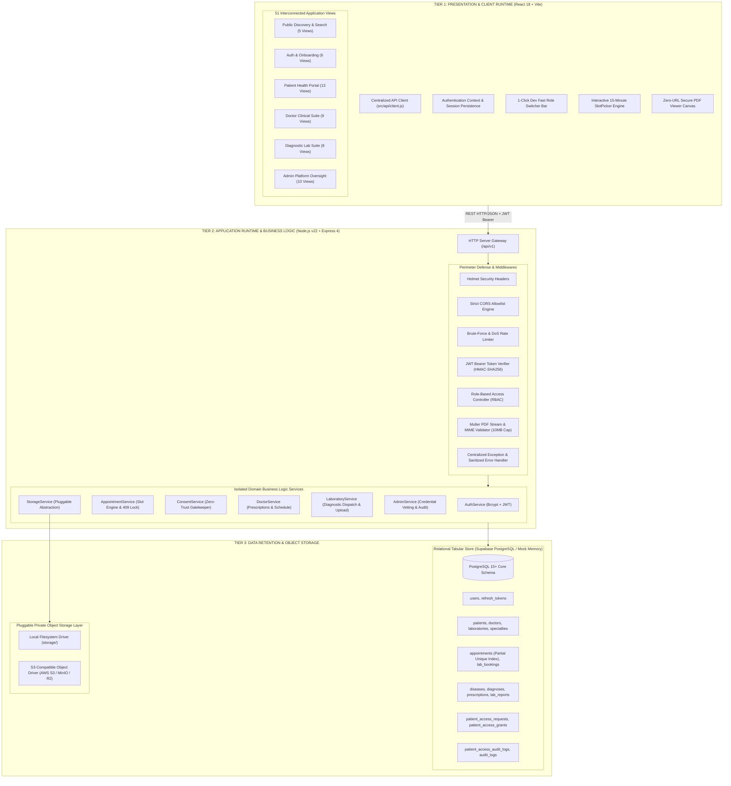
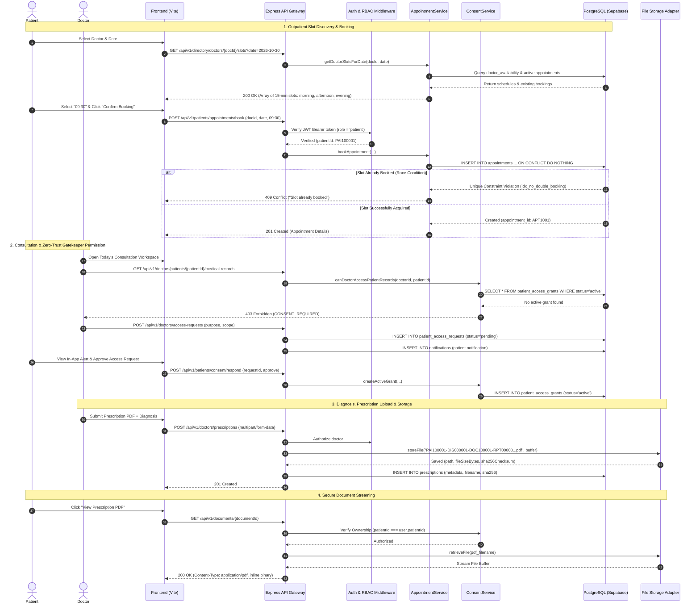
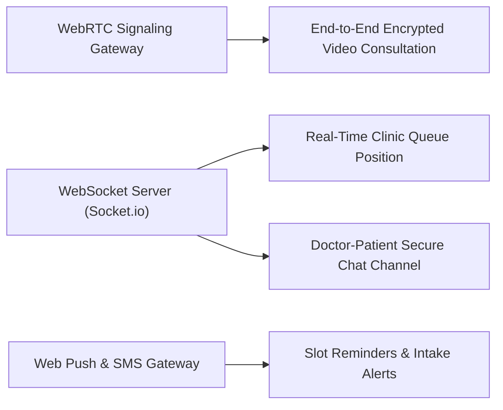

# Sushrut Healthcare Platform (सुश्रुत)
### *Next-Generation Secure Hospital Management, Clinical Resource Orchestration, and Zero-Trust Medical Vault*

[](https://nodejs.org/)
[](https://react.dev/)
[](https://vitejs.dev/)
[](https://supabase.com/)
[](https://tailwindcss.com/)
[](https://nodejs.org/api/test.html)
[](#7-security-governance-compliance--threat-mitigation)

---

## Table of Contents

1. [Executive Summary & Core Philosophy](#1-executive-summary--core-philosophy)
2. [Complete System Architecture & Three-Tier Engineering](#2-complete-system-architecture--three-tier-engineering)
   - [2.1 Tier 1: Presentation & Client State Engine (React 18 + Vite)](#21-tier-1-presentation--client-state-engine-react-18--vite)
   - [2.2 Tier 2: Application Core & Domain Services (Node.js + Express)](#22-tier-2-application-core--domain-services-nodejs--express)
   - [2.3 Tier 3: Structured Relational Data & Pluggable Storage Layer](#23-tier-3-structured-relational-data--pluggable-storage-layer)
   - [2.4 End-to-End Architectural Dataflow](#24-end-to-end-architectural-dataflow)
3. [Exhaustive Catalog of All 51 Implemented Pages](#3-exhaustive-catalog-of-all-51-implemented-pages)
   - [Category A: Public Discovery (5 Pages)](#category-a-public-discovery-5-pages)
   - [Category B: Authentication & Onboarding (6 Pages)](#category-b-authentication--onboarding-6-pages)
   - [Category C: Patient Portal (13 Pages)](#category-c-patient-portal-13-pages)
   - [Category D: Doctor Clinical Workspace (9 Pages)](#category-d-doctor-clinical-workspace-9-pages)
   - [Category E: Diagnostic Laboratory Portal (8 Pages)](#category-e-diagnostic-laboratory-portal-8-pages)
   - [Category F: Administrator Governance & Oversight (10 Pages)](#category-f-administrator-governance--oversight-10-pages)
4. [Deep-Dive Technical Innovations & Core Algorithms](#4-deep-dive-technical-innovations--core-algorithms)
   - [4.1 BookMyShow-Style 15-Minute Slot Scheduling Engine & Concurrency Locking](#41-bookmyshow-style-15-minute-slot-scheduling-engine--concurrency-locking)
   - [4.2 Patient-Controlled Consent Gatekeeper (Zero-Trust Record Access)](#42-patient-controlled-consent-gatekeeper-zero-trust-record-access)
   - [4.3 Storage Segregation Architecture: Zero PDF Blobs in PostgreSQL](#43-storage-segregation-architecture-zero-pdf-blobs-in-postgresql)
   - [4.4 Cryptographic Filename Enforcement & Deterministic Sequence Generators](#44-cryptographic-filename-enforcement--deterministic-sequence-generators)
5. [Comprehensive Database Schema & Relational Architecture](#5-comprehensive-database-schema--relational-architecture)
   - [5.1 Entity-Relationship Overview](#51-entity-relationship-overview)
   - [5.2 Sequence Generators & Formats](#52-sequence-generators--formats)
   - [5.3 Deep-Dive Table Specifications (21 Relational Tables)](#53-deep-dive-table-specifications-21-relational-tables)
6. [Complete REST API Specification (/api/v1)](#6-complete-rest-api-specification-apiv1)
   - [6.1 Global Request/Response Envelopes](#61-global-requestresponse-envelopes)
   - [6.2 Health & Diagnostic Endpoints](#62-health--diagnostic-endpoints)
   - [6.3 Authentication & Session Management (`/api/v1/auth`)](#63-authentication--session-management-apiv1auth)
   - [6.4 Public Directory & Search (`/api/v1/directory`)](#64-public-directory--search-apiv1directory)
   - [6.5 Patient Services (`/api/v1/patients`)](#65-patient-services-apiv1patients)
   - [6.6 Doctor Clinical Services (`/api/v1/doctors`)](#66-doctor-clinical-services-apiv1doctors)
   - [6.7 Laboratory Diagnostics (`/api/v1/laboratories`)](#67-laboratory-diagnostics-apiv1laboratories)
   - [6.8 Administrator Governance (`/api/v1/admin`)](#68-administrator-governance-apiv1admin)
   - [6.9 Zero-Trust Medical Document Streaming (`/api/v1/documents`)](#69-zero-trust-medical-document-streaming-apiv1documents)
   - [6.10 Patient Reviews & Ratings (`/api/v1/reviews`)](#610-patient-reviews--ratings-apiv1reviews)
   - [6.11 Notification Dispatch (`/api/v1/notifications`)](#611-notification-dispatch-apiv1notifications)
7. [Security Governance, Compliance & Threat Mitigation](#7-security-governance-compliance--threat-mitigation)
   - [7.1 Healthcare Compliance Alignment (HIPAA, DPDP, DISHA)](#71-healthcare-compliance-alignment-hipaa-dpdp-disha)
   - [7.2 Master Role-Based Access Control (RBAC) Matrix](#72-master-role-based-access-control-rbac-matrix)
   - [7.3 Cryptographic Standards & Integrity Protection](#73-cryptographic-standards--integrity-protection)
   - [7.4 Administrator Clinical Isolation Boundary](#74-administrator-clinical-isolation-boundary)
8. [Setup, Installation & Deployment Guide](#8-setup-installation--deployment-guide)
   - [8.1 Prerequisites & System Requirements](#81-prerequisites--system-requirements)
   - [8.2 Zero-Config Local Mode vs. Supabase Production Mode](#82-zero-config-local-mode-vs-supabase-production-mode)
   - [8.3 Step-by-Step Backend Deployment](#83-step-by-step-backend-deployment)
   - [8.4 Step-by-Step Frontend Deployment](#84-step-by-step-frontend-deployment)
   - [8.5 Environment Variable Reference Matrix](#85-environment-variable-reference-matrix)
   - [8.6 Automated Verification & Pre-Seeded Evaluation Credentials](#86-automated-verification--pre-seeded-evaluation-credentials)
9. [Future Scopes & Comprehensive Roadmap](#9-future-scopes--comprehensive-roadmap)
   - [Phase 1: Real-Time Communication & Telemedicine (Q1-Q2 2027)](#phase-1-real-time-communication--telemedicine-q1-q2-2027)
   - [Phase 2: National Health Stacks & Interoperability Standards (Q3 2027)](#phase-2-national-health-stacks--interoperability-standards-q3-2027)
   - [Phase 3: Multi-Tenant Enterprise Hospital Operating System (Q4 2027)](#phase-3-multi-tenant-enterprise-hospital-operating-system-q4-2027)
   - [Phase 4: Digital Health Twin Interface & Edge Analytics (2028 Horizon)](#phase-4-digital-health-twin-interface--edge-analytics-2028-horizon)
10. [Architectural Boundaries & Project Heritage](#10-architectural-boundaries--project-heritage)

---

## 1. Executive Summary & Core Philosophy

Named in homage to **Acharya Sushruta** (the ancient Indian physician revered as the founding father of surgery and clinical documentation), the **Sushrut Healthcare Platform** is an enterprise-grade, full-stack hospital management, outpatient scheduling, and medical resource orchestration platform. 

Engineered with modern full-stack web standards (**React 18**, **Node.js v22**, **Express 4**, and **Supabase PostgreSQL**), Sushrut addresses the fundamental structural defects of legacy electronic health record (EHR) and appointment booking software:

```
┌───────────────────────────────────────────────────────────────────────────────────┐
│                           THE FIVE SUSHRUT FIRST PRINCIPLES                       │
├───────────────────────────────────────────────────────────────────────────────────┤
│ 1. PATIENT DATA SOVEREIGNTY (Zero-Trust Gatekeeper)                               │
│    Patients have absolute ownership of their historical records. A confirmed      │
│    consultation does NOT automatically grant a doctor access to prior diagnoses.   │
│    Access requires explicit clinical justification, patient approval, and is      │
│    instantly revocable at any millisecond.                                        │
│                                                                                   │
│ 2. PHYSICAL STORAGE SEGREGATION (Zero Blobs in PostgreSQL)                       │
│    Relational databases are reserved strictly for structured tabular metadata,    │
│    relational pointers, and audit hashes. Medical PDF binaries are NEVER stored   │
│    as BYTEA/BLOB in PostgreSQL, eliminating write-amplification and WAL bloat.    │
│                                                                                   │
│ 3. DETERMINISTIC CRYPTOGRAPHIC NAMING CONVENTIONS                                │
│    All stored clinical files adhere to rigid, parseable, and cryptographically    │
│    traceable naming patterns, preventing parameter tampering and spoofing.        │
│                                                                                   │
│ 4. DETERMINISTIC 15-MINUTE APPOINTMENT CONCURRENCY LOCKING                       │
│    BookMyShow-style granular time slotting backed by database-level partial       │
│    unique constraints that eliminate double-booking race conditions under load.   │
│                                                                                   │
│ 5. COMPLETE ROLE ISOLATION & AUDIT INTEGRITY                                      │
│    Administrative users verify credentials and audit operational metrics but are  │
│    architecturally barred from ever reading clinical text or streaming PDF files. │
└───────────────────────────────────────────────────────────────────────────────────┘
```

The system provides 51 fully realized, production-ready React views across four specialized user portals (**Patient**, **Doctor**, **Diagnostic Laboratory**, and **Platform Administrator**), complemented by an unauthenticated public directory and authentication subsystem.

---

## 2. Complete System Architecture & Three-Tier Engineering

Sushrut is designed around a strictly decoupled **Three-Tier Architecture** that enforces clear operational boundaries between UI rendering, business domain services, structured relational data, and object storage.



---

### 2.1 Tier 1: Presentation & Client State Engine (React 18 + Vite)

The presentation tier is built as a single-page application (SPA) using **React 18.3.1** and bundled with **Vite 5.4**. It is architected for zero coupling with database primitives:
- **Zero Database Exposure:** The frontend has no knowledge of database credentials, Supabase service keys, or raw SQL queries. All interactions are strictly proxied via the REST API at `/api/v1`.
- **Layout Architecture:** Six modular layout components wrap nested React Router DOM (v6) routes:
  - `PublicLayout`: Responsive navigation header, brand hero, search bars, public directory links, and footer.
  - `AuthLayout`: Centered, distraction-free authentication card with branding and role selection.
  - `PatientLayout`, `DoctorLayout`, `LaboratoryLayout`, `AdminLayout`: Specialized role-based sidebars with persistent active navigation badges, unread notification counters, profile widgets, and security headers.
- **State & Session Persistence:** `AuthContext` tracks current user identity, role, profile identifiers (`PAI`, `DOC`, `LAB`), and JWT tokens in `localStorage`.
- **Fast Role Switcher:** A sticky global top toolbar (`RoleSwitcherBar`) available in development mode allows instant 1-click evaluation switching between Patient, Doctor, Lab, and Admin accounts without manual re-authentication.

### 2.2 Tier 2: Application Core & Domain Services (Node.js + Express)

Running on **Node.js v22 LTS**, the backend application tier adheres to a layered architecture:
```
Routes  ──>  Middleware  ──>  Controllers  ──>  Services  ──>  Repositories / Storage Adapters
```
- **Controller Layer:** Pure HTTP request parsing, input sanitization, and JSON response serialization.
- **Service Layer:** Transactional business rules, slot mathematical divisions, consent validation, cryptographic filename generation, and audit logging.
- **Repository Layer:** Abstracted data persistence supporting both a high-fidelity in-memory relational store (for zero-setup dev) and a native Supabase PostgreSQL pool (`pg.Pool`).
- **Middleware Suite:**
  - `helmet`: Sets `X-Content-Type-Options: nosniff`, `X-Frame-Options: DENY`, `Strict-Transport-Security`, and removes identifying headers.
  - `cors`: Restricts cross-origin requests to configured origins (`CLIENT_ORIGIN`, `FRONTEND_URL`, and local Vite dev servers).
  - `express-rate-limit`: Configured with a 15-minute sliding window limiting requests per IP address to throttle credential stuffing.
  - `multer`: Restricts document uploads strictly to `application/pdf` with a maximum payload cap of 10 MB.

### 2.3 Tier 3: Structured Relational Data & Pluggable Storage Layer

Tier 3 is partitioned into two physically separate domains to optimize performance and enforce compliance:
1. **Relational Tabular Database (PostgreSQL):** Supabase PostgreSQL manages relational dependencies, temporal schedules, role credentials, and consent tables. Document files are **never** converted to `BYTEA` or Base64 blobs in database rows. Instead, rows contain pointer references, MIME types, file sizes, and SHA-256 integrity checksums.
2. **Pluggable Storage Abstraction (`StorageAdapter`):** A unified interface (`storeFile`, `retrieveFile`, `deleteFile`, `fileExists`, `getMetadata`) with two pluggable drivers:
   - `LocalStorageAdapter`: Employs Node's `fs.promises` with path-traversal guards (`path.resolve` containment checks) writing to `../storage/`.
   - `S3StorageAdapter`: Implements S3-compatible commands for production deployments across AWS S3, Cloudflare R2, MinIO, or Supabase Storage.

---

### 2.4 End-to-End Architectural Dataflow

The diagram below details the sequence of execution when a patient searches for a doctor, books a slot, attends a consultation, grants consent, and accesses generated records:



---

## 3. Exhaustive Catalog of All 51 Implemented Pages

Sushrut includes **51 fully implemented React pages** organized across six functional categories. Every page includes loading states, responsive viewports, API integration, and error boundaries.

```
┌────────────────────────────────────────────────────────────────────────┐
│                        PAGE CATALOG BREAKDOWN                          │
├──────────────────────────────────────┬─────────────────────────────────┤
│ Category                             │ Count                           │
├──────────────────────────────────────┼─────────────────────────────────┤
│ A. Public Discovery Directory        │ 5 Pages                         │
│ B. Authentication & Onboarding       │ 6 Pages                         │
│ C. Patient Health Portal             │ 13 Pages                        │
│ D. Doctor Clinical Suite             │ 9 Pages                         │
│ E. Diagnostic Laboratory Portal      │ 8 Pages                         │
│ F. Platform Administrator Oversight  │ 10 Pages                        │
├──────────────────────────────────────┼─────────────────────────────────┤
│ TOTAL IMPLEMENTED PAGES              │ 51 Pages                        │
└──────────────────────────────────────┴─────────────────────────────────┘
```

---

### Category A: Public Discovery (5 Pages)

Accessible without authentication. Allows patients and family members to discover qualified medical professionals and diagnostic facilities.

| Page Name | React Component Path | Route Pattern | Functional Description & Capabilities |
| :--- | :--- | :--- | :--- |
| **Home Page** | [`HomePage.jsx`](file:///home/gaurang/Sushrut/frontend/src/pages/public/HomePage.jsx) | `/` | Hero section with two search modes (Find Doctors vs. Find Labs), 9 quick-access specialty chips, stats banner, featured doctors carousel, and certified laboratory accreditations. |
| **Find Doctors** | [`FindDoctorsPage.jsx`](file:///home/gaurang/Sushrut/frontend/src/pages/public/FindDoctorsPage.jsx) | `/doctors` | Public search directory featuring multi-filter facets: specialty dropdown, city filtering, keyword searching, minimum rating (1-10), maximum fee slider, and sorting (`rating`, `fee_asc`, `fee_desc`, `experience`). |
| **Doctor Profile** | [`DoctorProfilePage.jsx`](file:///home/gaurang/Sushrut/frontend/src/pages/public/DoctorProfilePage.jsx) | `/doctors/:doctorId` | Comprehensive clinical biography, medical degrees, medical council registration number, clinic address, interactive map coordinates, consultation fee, weekly schedule overview, and verified patient reviews. |
| **Find Laboratories** | [`FindLaboratoriesPage.jsx`](file:///home/gaurang/Sushrut/frontend/src/pages/public/FindLaboratoriesPage.jsx) | `/laboratories` | Diagnostic laboratory directory with instant filters for home sample collection availability, city locations, and NABL accreditation status. |
| **Laboratory Profile** | [`LaboratoryProfilePage.jsx`](file:///home/gaurang/Sushrut/frontend/src/pages/public/LaboratoryProfilePage.jsx) | `/laboratories/:laboratoryId` | Diagnostic centre profile displaying operational hours, address, home collection fee policies, and full searchable catalog of diagnostic tests with turnaround times and prices. |

---

### Category B: Authentication & Onboarding (6 Pages)

Secure entry points for all roles, featuring validation, role segregation, and rapid dev testing helpers.

| Page Name | React Component Path | Route Pattern | Functional Description & Capabilities |
| :--- | :--- | :--- | :--- |
| **Login** | [`LoginPage.jsx`](file:///home/gaurang/Sushrut/frontend/src/pages/auth/LoginPage.jsx) | `/login` | Unified email/password sign-in interface. Features a **1-Click Test Role Switcher** to immediately authenticate as Patient, Doctor, Lab, or Admin with pre-seeded accounts. |
| **Register Patient** | [`RegisterPatientPage.jsx`](file:///home/gaurang/Sushrut/frontend/src/pages/auth/RegisterPatientPage.jsx) | `/register/patient` | Multi-field patient registration form capturing demographics, date of birth, blood group, emergency contact details, allergies, and chronic conditions. Automatically issues a `PAI######` sequence ID. |
| **Register Doctor** | [`RegisterDoctorPage.jsx`](file:///home/gaurang/Sushrut/frontend/src/pages/auth/RegisterDoctorPage.jsx) | `/register/doctor` | Onboarding form capturing specialty, medical council registration number, medical qualifications, experience years, clinic address, and consultation fee. Accounts are created with `pending` verification status. |
| **Register Laboratory**| [`RegisterLaboratoryPage.jsx`](file:///home/gaurang/Sushrut/frontend/src/pages/auth/RegisterLaboratoryPage.jsx) | `/register/laboratory` | Diagnostic centre onboarding form capturing NABL accreditation number, operating hours, home collection capabilities, and dispatch addresses. Status defaults to `pending` review. |
| **Forgot Password** | [`ForgotPasswordPage.jsx`](file:///home/gaurang/Sushrut/frontend/src/pages/auth/ForgotPasswordPage.jsx) | `/forgot-password` | Self-service recovery initiation with rate-limiting and email existence checking. Simulates secure password reset delivery. |
| **Reset Password** | [`ResetPasswordPage.jsx`](file:///home/gaurang/Sushrut/frontend/src/pages/auth/ResetPasswordPage.jsx) | `/reset-password` | Token-verified password modification interface enforcing password complexity (minimum 8 characters, numbers, and symbols). |

---

### Category C: Patient Portal (13 Pages)

Dedicated, authenticated workspace for patients to manage consultations, book tests, review documents, and control consent.

| Page Name | React Component Path | Route Pattern | Functional Description & Capabilities |
| :--- | :--- | :--- | :--- |
| **Patient Dashboard** | [`PatientDashboardPage.jsx`](file:///home/gaurang/Sushrut/frontend/src/pages/patient/PatientDashboardPage.jsx) | `/patient/dashboard` | Central health overview showing next upcoming consultation card, quick-book shortcuts, recent digital prescriptions, diagnostic reports overview, active consent grants, and health vitals widget. |
| **Search Doctors** | [`PatientDoctorSearchPage.jsx`](file:///home/gaurang/Sushrut/frontend/src/pages/patient/PatientDoctorSearchPage.jsx) | `/patient/doctors` | Authenticated doctor discovery interface with direct integration into the slot booking pipeline. |
| **Doctor Details** | [`PatientDoctorDetailsPage.jsx`](file:///home/gaurang/Sushrut/frontend/src/pages/patient/PatientDoctorDetailsPage.jsx) | `/patient/doctors/:doctorId` | In-depth doctor credentials view with direct "Book Consultation" triggers and past consultation history with this physician. |
| **Book Appointment** | [`BookAppointmentPage.jsx`](file:///home/gaurang/Sushrut/frontend/src/pages/patient/BookAppointmentPage.jsx) | `/patient/appointments/book/:doctorId` | **BookMyShow-Style 15-Minute Slot Picker**. Generates date picker, splits consultation day into Morning, Afternoon, and Evening buckets, and shows live availability status. |
| **Appointment Confirmation**| [`AppointmentConfirmationPage.jsx`](file:///home/gaurang/Sushrut/frontend/src/pages/patient/AppointmentConfirmationPage.jsx) | `/patient/appointments/confirmation/:appointmentId`| Visual booking summary with consultation token `APT####`, clinic directions, preparation instructions, calendar export, and print summary action. |
| **My Appointments** | [`MyAppointmentsPage.jsx`](file:///home/gaurang/Sushrut/frontend/src/pages/patient/MyAppointmentsPage.jsx) | `/patient/appointments` | Tabbed view of consultations: **Upcoming**, **Completed**, and **Cancelled**. Enables slot rescheduling, appointment cancellation, and review submission. |
| **Appointment Details** | [`AppointmentDetailsPage.jsx`](file:///home/gaurang/Sushrut/frontend/src/pages/patient/AppointmentDetailsPage.jsx) | `/patient/appointments/:appointmentId` | Four-stage consultation lifecycle tracker (`Confirmed` → `Checked In` → `In Consultation` → `Completed`) with symptom summaries and doctor notes. |
| **Medical Records Vault**| [`MedicalRecordsPage.jsx`](file:///home/gaurang/Sushrut/frontend/src/pages/patient/MedicalRecordsPage.jsx) | `/patient/medical-records` | Centralized personal health vault organizing historical diagnoses, clinical prescriptions, and diagnostic lab reports with search and filter capabilities. |
| **Prescriptions List** | [`PrescriptionsPage.jsx`](file:///home/gaurang/Sushrut/frontend/src/pages/patient/PrescriptionsPage.jsx) | `/patient/prescriptions` | Digital prescription archive displaying issuing doctor, disease classification, prescribed medications, dosage schedules, and direct PDF viewer links. |
| **Laboratory Reports** | [`LaboratoryReportsPage.jsx`](file:///home/gaurang/Sushrut/frontend/src/pages/patient/LaboratoryReportsPage.jsx) | `/patient/laboratory-reports` | Diagnostic lab test archive featuring status pills (`Normal`, `Abnormal`, `Critical`), sample collection dates, and direct links to certified PDF lab reports. |
| **Document Viewer** | [`DocumentViewerPage.jsx`](file:///home/gaurang/Sushrut/frontend/src/pages/patient/DocumentViewerPage.jsx) | `/patient/documents/:documentId` | **Zero-URL Secure PDF Viewer**. Features zoom in/out controls, print dialogue, full-screen canvas, and download capabilities. Streams directly from the secure backend. |
| **Book Lab Tests** | [`BookLabTestsPage.jsx`](file:///home/gaurang/Sushrut/frontend/src/pages/patient/BookLabTestsPage.jsx) | `/patient/laboratory-tests` | Diagnostic order builder. Allows selection of tests (e.g., HbA1c, Lipid Profile), choice between Clinic Visit and Home Collection, date/time slot selection, and address confirmation. |
| **Patient Profile & Consent**| [`PatientProfilePage.jsx`](file:///home/gaurang/Sushrut/frontend/src/pages/patient/PatientProfilePage.jsx) | `/patient/profile` | Personal demographic manager and **Patient Consent Control Center**. Allows patients to review pending doctor record requests and revoke active grants with immediate effect. |

---

### Category D: Doctor Clinical Workspace (9 Pages)

Designed for medical practitioners to run clinics, manage appointment queues, review patient histories, and issue prescriptions.

| Page Name | React Component Path | Route Pattern | Functional Description & Capabilities |
| :--- | :--- | :--- | :--- |
| **Doctor Dashboard** | [`DoctorDashboardPage.jsx`](file:///home/gaurang/Sushrut/frontend/src/pages/doctor/DoctorDashboardPage.jsx) | `/doctor/dashboard` | Clinical overview displaying today's patient queue, total consultation count, average patient review rating, pending access requests, and quick consultation shortcuts. |
| **Today's Appointments**| [`TodayAppointmentsPage.jsx`](file:///home/gaurang/Sushrut/frontend/src/pages/doctor/TodayAppointmentsPage.jsx) | `/doctor/appointments/today` | Real-time daily patient queue displaying 15-minute slot times, patient names, chief complaints, and record access consent status pills. |
| **Appointment Calendar**| [`AppointmentCalendarPage.jsx`](file:///home/gaurang/Sushrut/frontend/src/pages/doctor/AppointmentCalendarPage.jsx) | `/doctor/calendar` | Interactive monthly calendar displaying patient consultation volume per date, past appointment histories, and future booked schedules. |
| **Manage Availability** | [`ManageAvailabilityPage.jsx`](file:///home/gaurang/Sushrut/frontend/src/pages/doctor/ManageAvailabilityPage.jsx) | `/doctor/availability` | **Weekly Recurring Schedule & Slot Engine Configurator**. Allows doctors to configure working days, start/end hours, and slot duration intervals (15, 20, 30, 45, 60 minutes) with instant slot preview. |
| **Appointment Details** | [`DoctorAppointmentDetailsPage.jsx`](file:///home/gaurang/Sushrut/frontend/src/pages/doctor/DoctorAppointmentDetailsPage.jsx) | `/doctor/appointments/:appointmentId` | Comprehensive consultation workspace with patient profile overview, symptom description, medical record consent status, and navigation to the prescription writer. |
| **Patient Access Requests**| [`PatientAccessRequestsPage.jsx`](file:///home/gaurang/Sushrut/frontend/src/pages/doctor/PatientAccessRequestsPage.jsx) | `/doctor/patient-access-requests` | Consent request tracking dashboard. Shows all outgoing patient record requests, clinical purpose notes, requested scopes, and current statuses (`pending`, `approved`, `rejected`). |
| **Patient Medical Records**| [`PatientMedicalRecordsPage.jsx`](file:///home/gaurang/Sushrut/frontend/src/pages/doctor/PatientMedicalRecordsPage.jsx) | `/doctor/patients/:patientId/medical-records` | **Consent-Gated Clinical Records View**. If consent is active, displays the patient's full medical history; if no grant exists, displays a permission-blocked gatekeeper card with a 1-click access request form. |
| **Diagnosis & Prescription**| [`DiagnosisPrescriptionPage.jsx`](file:///home/gaurang/Sushrut/frontend/src/pages/doctor/DiagnosisPrescriptionPage.jsx) | `/doctor/appointments/:appointmentId/prescription` | Clinical prescription generator. Captures ICD disease categorization, clinical diagnosis notes, dynamic medication rows (name, dose, frequency, timing), and follow-up advice, outputting a standardized PDF. |
| **Doctor Profile Settings**| [`DoctorOwnProfilePage.jsx`](file:///home/gaurang/Sushrut/frontend/src/pages/doctor/DoctorProfilePage.jsx) | `/doctor/profile` | Doctor biography editor, clinic location address modifier, consultation fee settings, qualifications list, and credential verification status display. |

---

### Category E: Diagnostic Laboratory Portal (8 Pages)

Equips certified diagnostic centres and pathology laboratories to manage service catalogs, home sample collection dispatch, and report uploads.

| Page Name | React Component Path | Route Pattern | Functional Description & Capabilities |
| :--- | :--- | :--- | :--- |
| **Laboratory Dashboard**| [`LaboratoryDashboardPage.jsx`](file:///home/gaurang/Sushrut/frontend/src/pages/laboratory/LaboratoryDashboardPage.jsx) | `/laboratory/dashboard` | Operational control room showing today's sample collection queue, total tests processed, turnaround metrics, and pending report upload counts. |
| **Laboratory Profile** | [`LaboratoryOwnProfilePage.jsx`](file:///home/gaurang/Sushrut/frontend/src/pages/laboratory/LaboratoryProfilePage.jsx) | `/laboratory/profile` | Diagnostic centre information, operational address, contact numbers, and NABL accreditation credential display. |
| **Manage Services** | [`ManageServicesPage.jsx`](file:///home/gaurang/Sushrut/frontend/src/pages/laboratory/ManageServicesPage.jsx) | `/laboratory/services` | Test catalog and pricing manager. Enables labs to activate/deactivate tests from the master catalog, adjust local pricing, and toggle home sample collection. |
| **Test Bookings Queue** | [`TestBookingsPage.jsx`](file:///home/gaurang/Sushrut/frontend/src/pages/laboratory/TestBookingsPage.jsx) | `/laboratory/bookings` | Incoming diagnostic order queue with status filtering: `confirmed`, `sample_collected`, `processing`, and `completed`. Displays pickup addresses for home collection orders. |
| **Booking Details** | [`LaboratoryBookingDetailsPage.jsx`](file:///home/gaurang/Sushrut/frontend/src/pages/laboratory/LaboratoryBookingDetailsPage.jsx) | `/laboratory/bookings/:bookingId` | Individual order workflow view. Allows dispatch staff to update sample collection statuses and view patient contact information. |
| **Upload Lab Report** | [`UploadReportPage.jsx`](file:///home/gaurang/Sushrut/frontend/src/pages/laboratory/UploadReportPage.jsx) | `/laboratory/reports/upload` | Certified PDF report uploader. Enforces the naming convention `PATIENT_ID-TEST_ID-LAB_ID-REPORT_ID.pdf`, captures biomarker readings as JSON, and flags clinical statuses (`Normal`, `Abnormal`, `Critical`). |
| **Report History** | [`ReportHistoryPage.jsx`](file:///home/gaurang/Sushrut/frontend/src/pages/laboratory/ReportHistoryPage.jsx) | `/laboratory/reports` | Complete historical archive of all diagnostic reports uploaded by this facility, with filterable dates and verification metadata. |
| **Laboratory Settings** | [`LaboratorySettingsPage.jsx`](file:///home/gaurang/Sushrut/frontend/src/pages/laboratory/LaboratorySettingsPage.jsx) | `/laboratory/settings` | Operating hours configuration, holiday exceptions, and home sample collection fees and radius settings. |

---

### Category F: Administrator Governance & Oversight (10 Pages)

Administrative oversight suite for hospital directors and platform administrators. Built with strict privacy boundaries: **Administrators cannot view or download clinical documents**.

| Page Name | React Component Path | Route Pattern | Functional Description & Capabilities |
| :--- | :--- | :--- | :--- |
| **Admin Dashboard** | [`AdminDashboardPage.jsx`](file:///home/gaurang/Sushrut/frontend/src/pages/admin/AdminDashboardPage.jsx) | `/admin/dashboard` | High-level platform metrics: total patients, verified doctors, pending doctor applications, accredited laboratories, active appointments, and system health status. |
| **Pending Doctors Queue**| [`PendingDoctorsPage.jsx`](file:///home/gaurang/Sushrut/frontend/src/pages/admin/PendingDoctorsPage.jsx) | `/admin/doctors/pending` | Verification queue of newly registered medical doctors awaiting credential inspection. |
| **Doctor Verification** | [`DoctorVerificationPage.jsx`](file:///home/gaurang/Sushrut/frontend/src/pages/admin/DoctorVerificationPage.jsx) | `/admin/doctors/:doctorId/verification`| Credential review workspace: displays doctor qualifications, council registration numbers, clinic details, and allows approval or rejection with audit notes. |
| **Pending Laboratories**| [`PendingLaboratoriesPage.jsx`](file:///home/gaurang/Sushrut/frontend/src/pages/admin/PendingLaboratoriesPage.jsx) | `/admin/laboratories/pending`| Verification queue of diagnostic laboratories awaiting NABL certification review. |
| **Laboratory Verification**| [`LaboratoryVerificationPage.jsx`](file:///home/gaurang/Sushrut/frontend/src/pages/admin/LaboratoryVerificationPage.jsx)| `/admin/laboratories/:laboratoryId/verification`| NABL certificate evaluation workspace with decision approval/rejection triggers and compliance logging. |
| **Patient Directory** | [`PatientManagementPage.jsx`](file:///home/gaurang/Sushrut/frontend/src/pages/admin/PatientManagementPage.jsx) | `/admin/patients` | Complete patient account directory with status toggles, registration timestamps, and account status management (active/suspended). |
| **Doctor Directory** | [`DoctorManagementPage.jsx`](file:///home/gaurang/Sushrut/frontend/src/pages/admin/DoctorManagementPage.jsx) | `/admin/doctors` | Complete directory of registered physicians with verification status indicators and account suspension toggles. |
| **Laboratory Directory**| [`LaboratoryManagementPage.jsx`](file:///home/gaurang/Sushrut/frontend/src/pages/admin/LaboratoryManagementPage.jsx) | `/admin/laboratories` | Directory of registered diagnostic facilities with NABL numbers and active service status controls. |
| **Appointment Oversight**| [`AppointmentOversightPage.jsx`](file:///home/gaurang/Sushrut/frontend/src/pages/admin/AppointmentOversightPage.jsx) | `/admin/appointments` | Platform-wide operational consultation tracker showing volume across specialties, completion rates, and cancellation frequencies. |
| **Platform Audit Logs** | [`AdminSettingsAuditLogsPage.jsx`](file:///home/gaurang/Sushrut/frontend/src/pages/admin/AdminSettingsAuditLogsPage.jsx) | `/admin/settings` | Immutable audit trail displaying administrative actions, authentication events, IP addresses, and timestamps. **Clinical document contents remain strictly inaccessible**. |

---

## 4. Deep-Dive Technical Innovations & Core Algorithms

---

### 4.1 BookMyShow-Style 15-Minute Slot Scheduling Engine & Concurrency Locking

In outpatient healthcare, booking conflicts cause clinic delays and patient dissatisfaction. Sushrut implements a slot scheduling engine inspired by high-concurrency ticketing systems (such as BookMyShow):

```
┌───────────────────────────────────────────────────────────────────────────────────┐
│               15-MINUTE SLOT ENGINE & CONCURRENCY CONTROL PIPELINE                │
├───────────────────────────────────────────────────────────────────────────────────┤
│ 1. Weekly Rule Extraction                                                         │
│    Doctor defines weekly active blocks in doctor_availability                     │
│    (e.g., Monday 09:00 - 13:00, 14:00 - 18:00 with 15-minute slot durations).     │
│                                                                                   │
│ 2. Discrete Time Slicing Algorithm                                                │
│    Converts window [start_time, end_time] into non-overlapping discrete intervals:   │
│    Slot_i = [T_start + (i × duration), T_start + ((i+1) × duration)]              │
│    Bucketed into periods: Morning (< 12:00), Afternoon (12:00-16:00),             │
│    Evening (≥ 16:00).                                                             │
│                                                                                   │
│ 3. Pre-Flight State Overlay                                                       │
│    Queries active appointments for (doctor_id, appointment_date) WHERE            │
│    status != 'cancelled'. Existing slots are tagged as unavailable.               │
│                                                                                   │
│ 4. Atomic Concurrency Lock (PostgreSQL Partial Unique Constraint)                 │
│    When two requests attempt to book the exact same slot concurrently:            │
│                                                                                   │
│    CREATE UNIQUE INDEX idx_no_double_booking                                      │
│    ON appointments(doctor_id, appointment_date, start_time)                       │
│    WHERE status NOT IN ('cancelled');                                             │
│                                                                                   │
│    Transaction A commits; Transaction B violates the constraint and               │
│    immediately yields an HTTP 409 Conflict exception.                             │
└───────────────────────────────────────────────────────────────────────────────────┘
```

#### Time-Window Chunking Implementation (`appointment.service.js`)
```javascript
// Discrete time interval calculation
const [startHour, startMin] = rule.start_time.split(':').map(Number);
const [endHour, endMin] = rule.end_time.split(':').map(Number);

let currentMinute = startHour * 60 + startMin;
const endMinute = endHour * 60 + endMin;

while (currentMinute + slotDuration <= endMinute) {
  const h = Math.floor(currentMinute / 60);
  const m = currentMinute % 60;
  const timeStr = `${String(h).padStart(2, '0')}:${String(m).padStart(2, '0')}`;
  
  const nextMin = currentMinute + slotDuration;
  const nh = Math.floor(nextMin / 60);
  const nm = nextMin % 60;
  const endTimeStr = `${String(nh).padStart(2, '0')}:${String(nm).padStart(2, '0')}`;

  const isBooked = bookedStartTimes.has(timeStr);
  let period = 'morning';
  if (h >= 12 && h < 16) period = 'afternoon';
  else if (h >= 16) period = 'evening';

  slots.push({
    time: timeStr,
    endTime: endTimeStr,
    period,
    available: !isBooked,
    status: isBooked ? 'booked' : 'available'
  });

  currentMinute += slotDuration;
}
```

---

### 4.2 Patient-Controlled Consent Gatekeeper (Zero-Trust Record Access)

Unlike traditional hospital management systems where any staff member or physician can view a patient's historical diagnoses, Sushrut enforces a **Zero-Trust Consent Gatekeeper**:

```
      Doctor Console                       Consent Service                      Patient Portal
            │                                     │                                    │
            │─── 1. Query Patient Records ───────>│                                    │
            │    GET /doctors/patients/{id}/recs  │                                    │
            │                                     │─── 2. Evaluate Active Grants ─────>│
            │                                     │    (None exists or expired)        │
            │<── 3. 403 Forbidden ────────────────│                                    │
            │    { code: "CONSENT_REQUIRED" }     │                                    │
            │                                     │                                    │
            │─── 4. Submit Access Request ───────>│                                    │
            │    (Clinical purpose, scope)        │                                    │
            │                                     │─── 5. Dispatch Alert ─────────────>│
            │                                     │    In-App Notification Received    │
            │                                     │                                    │
            │                                     │<── 6. Grant Access Permission ─────│
            │                                     │    POST /patients/consent/respond  │
            │                                     │                                    │
            │─── 7. Re-query Patient Records ────>│                                    │
            │<── 8. 200 OK (Clinical Data) ───────│                                    │
            │                                     │                                    │
            │                                     │<── 9. Revoke Permission ───────────│
            │                                     │    POST /patients/consent/revoke   │
            │                                     │                                    │
            │─── 10. Attempt Further Retrieval ──>│                                    │
            │<── 11. 403 Forbidden (Revoked) ─────│                                    │
```

#### Gatekeeper Implementation Highlights:
- **Default-Denied:** Having an appointment confirmation does **not** grant record access. Access requires an explicit grant in `patient_access_grants`.
- **Granular Scopes:** Consent can be limited to:
  - `all_records`: Complete historical vault.
  - `prescriptions_only`: Prior medications and diagnoses only.
  - `lab_reports_only`: Diagnostic pathology findings only.
  - `single_appointment`: Records created during the active consultation session only.
- **Immediate Server-Side Revocation:** When a patient revokes consent via `POST /api/v1/patients/consent/revoke`, the grant's status is set to `revoked` with a timestamp. Any subsequent request by the doctor immediately returns `403 Forbidden`.
- **Immutable Audit Logging:** Every access attempt—both allowed and denied—is recorded in `patient_access_audit_logs` with the actor's user ID, IP address, resource ID, action, and outcome.

---

### 4.3 Storage Segregation Architecture: Zero PDF Blobs in PostgreSQL

A common anti-pattern in healthcare software is storing binary medical files directly within relational databases as `BYTEA` or Base64 encoded columns. In Sushrut, medical document binaries are **strictly segregated** from PostgreSQL:

```
┌───────────────────────────────────────────────────────────────────────────────────┐
│                        PHYSICAL STORAGE SEGREGATION MODEL                         │
├───────────────────────────────────────────────────────────────────────────────────┤
│                                                                                   │
│   POSTGRESQL TABULAR DATABASE                    EXTERNAL OBJECT STORAGE          │
│   (Supabase / PostgreSQL Core)                   (Local Disk / S3 / MinIO / R2)   │
│  ┌───────────────────────────────┐              ┌──────────────────────────────┐  │
│  │ TABLE: prescriptions          │              │ Bucket: sushrut-documents    │  │
│  ├───────────────────────────────┤              ├──────────────────────────────┤  │
│  │ id: "uuid-v4-record"          │              │ File:                        │  │
│  │ patient_id: "PAI100001"       │              │ PAI100001-DIS000001-DOC100001│  │
│  │ doctor_id: "DOC100001"        │              │ -RPT000001.pdf               │  │
│  │ disease_id: "DIS000001"       │              │                              │  │
│  │ pdf_filename: "...pdf"        │─────────────>│ Binary payload (PDF 1.4-1.7) │  │
│  │ file_size_bytes: 348192       │              │ Streamed through proxy with  │  │
│  │ checksum_sha256: "9f8a...c3"  │              │ zero direct public URLs.     │  │
│  │ mime_type: "application/pdf"  │              └──────────────────────────────┘  │
│  └───────────────────────────────┘                                                │
│                                                                                   │
│  BENEFITS:                                                                        │
│  • Eliminates database WAL write-amplification and table vacuum bloat.            │
│  • PostgreSQL buffer pool memory is preserved entirely for hot tabular rows.     │
│  • Eliminates risk of direct public link exposure via S3 bucket misconfiguration. │
│  • Enables independent lifecycle policies and geographic encryption for files.   │
└───────────────────────────────────────────────────────────────────────────────────┘
```

#### Zero Direct Public URLs & Proxied Streaming
Medical documents are **never accessible via direct public URLs**. Documents are retrieved exclusively through the backend streaming endpoint:
```http
GET /api/v1/documents/:documentId
```
When invoked, `DocumentController`:
1. Verifies the caller's JWT Bearer token.
2. Checks role authorization:
   - Patient: Confirms `record.patient_id === user.patientId`.
   - Doctor: Evaluates active consent via `ConsentService.canDoctorAccessPatientRecords`.
   - Laboratory: Confirms report was issued by their laboratory (`record.lab_id === user.labId`).
   - Administrator: Access is **explicitly denied** with `403 Forbidden`.
3. Streams the file buffer from the storage adapter with headers:
   - `Content-Type: application/pdf`
   - `Content-Disposition: inline; filename="PAI100001-..."`

---

### 4.4 Cryptographic Filename Enforcement & Deterministic Sequence Generators

To prevent path traversal, filename collision, and cross-patient spoofing, all stored files use standardized filenames validated by strict regular expressions:

```
┌───────────────────────────────────────────────────────────────────────────────────┐
│                     STANDARDIZED MEDICAL FILENAME FORMATS                         │
├───────────────────────────────────────────────────────────────────────────────────┤
│ 1. LABORATORY DIAGNOSTIC REPORTS:                                                 │
│    Pattern:  PATIENT_ID-TEST_ID-LAB_ID-REPORT_ID.pdf                              │
│    Example:  PAI100001-TST000001-LAB100001-RPT000001.pdf                         │
│    Regex:    ^PAI\d+-TST\d+-LAB\d+-RPT\d+\.pdf$                                   │
│                                                                                   │
│ 2. CLINICAL OUTPATIENT PRESCRIPTIONS:                                             │
│    Pattern:  PATIENT_ID-DISEASE_ID-DOCTOR_ID-RECORD_ID.pdf                        │
│    Example:  PAI100001-DIS000001-DOC100001-RPT000001.pdf                         │
│    Regex:    ^PAI\d+-DIS\d+-DOC\d+-RPT\d+\.pdf$                                   │
└───────────────────────────────────────────────────────────────────────────────────┘
```

#### Filename Validation Implementation (`backend/src/utils/filenames.js`)
```javascript
export function generateLabReportFilename({ patientId, testId, labId, reportId }) {
  if (!patientId || !testId || !labId || !reportId) {
    throw new Error('All segments (patientId, testId, labId, reportId) are required.');
  }
  return `${patientId}-${testId}-${labId}-${reportId}.pdf`;
}

export function generatePrescriptionFilename({ patientId, diseaseId, doctorId, recordId }) {
  if (!patientId || !diseaseId || !doctorId || !recordId) {
    throw new Error('All segments (patientId, diseaseId, doctorId, recordId) are required.');
  }
  return `${patientId}-${diseaseId}-${doctorId}-${recordId}.pdf`;
}

export function validateLabReportFilename(filename) {
  return /^PAI\d+-TST\d+-LAB\d+-RPT\d+\.pdf$/.test(filename);
}

export function validatePrescriptionFilename(filename) {
  return /^PAI\d+-DIS\d+-DOC\d+-RPT\d+\.pdf$/.test(filename);
}
```

---

## 5. Comprehensive Database Schema & Relational Architecture

The relational schema is defined in [`database/supabase-schema.sql`](file:///home/gaurang/Sushrut/database/supabase-schema.sql) and spans 21 tables and 8 sequences.

### 5.1 Entity-Relationship Overview

```mermaid
erDiagram
    USERS ||--o| PATIENTS : "has profile"
    USERS ||--o| DOCTORS : "has profile"
    USERS ||--o| LABORATORIES : "has profile"
    USERS ||--o{ REFRESH_TOKENS : "maintains sessions"
    USERS ||--o{ NOTIFICATIONS : "receives"
    USERS ||--o{ AUDIT_LOGS : "generates"

    SPECIALTIES ||--o{ DOCTORS : "primary specialty"
    SPECIALTIES ||--o{ DOCTOR_SPECIALTIES : "associates"
    DOCTORS ||--o{ DOCTOR_SPECIALTIES : "possesses"
    DOCTORS ||--o{ DOCTOR_AVAILABILITY : "configures"
    DOCTORS ||--o{ DOCTOR_AVAILABILITY_EXCEPTIONS : "schedules leaves"

    PATIENTS ||--o{ APPOINTMENTS : "reserves"
    DOCTORS ||--o{ APPOINTMENTS : "hosts"
    APPOINTMENTS ||--o| DOCTOR_REVIEWS : "rated in"

    LABORATORIES ||--o{ LABORATORY_OFFERINGS : "publishes"
    TEST_CATALOGUE ||--o{ LABORATORY_OFFERINGS : "defines"
    PATIENTS ||--o{ LABORATORY_BOOKINGS : "books"
    LABORATORIES ||--o{ LABORATORY_BOOKINGS : "fulfills"
    TEST_CATALOGUE ||--o{ LABORATORY_BOOKINGS : "ordered for"

    DISEASES_CATALOGUE ||--o{ DIAGNOSES : "classifies"
    PATIENTS ||--o{ DIAGNOSES : "receives"
    DOCTORS ||--o{ DIAGNOSES : "authors"

    PATIENTS ||--o{ PRESCRIPTIONS : "issued to"
    DOCTORS ||--o{ PRESCRIPTIONS : "prescribed by"
    DISEASES_CATALOGUE ||--o{ PRESCRIPTIONS : "targets"
    APPOINTMENTS ||--o| PRESCRIPTIONS : "originates from"

    PATIENTS ||--o{ LABORATORY_REPORTS : "diagnosed in"
    LABORATORIES ||--o{ LABORATORY_REPORTS : "uploads"
    TEST_CATALOGUE ||--o{ LABORATORY_REPORTS : "evaluates"

    PATIENTS ||--o{ PATIENT_ACCESS_REQUESTS : "requested from"
    DOCTORS ||--o{ PATIENT_ACCESS_REQUESTS : "requests"
    PATIENTS ||--o{ PATIENT_ACCESS_GRANTS : "grants"
    DOCTORS ||--o{ PATIENT_ACCESS_GRANTS : "receives"
    PATIENTS ||--o{ PATIENT_ACCESS_AUDIT_LOGS : "audits views for"
```



---

### 5.2 Sequence Generators & Formats

| Sequence Name | Prefix | Start Value | Regex Pattern | Format Example | Entity |
| :--- | :--- | :--- | :--- | :--- | :--- |
| `seq_patient_id` | `PAI` | `100001` | `^PAI\d{6}$` | `PAI100001` | Registered Patient |
| `seq_doctor_id` | `DOC` | `100001` | `^DOC\d{6}$` | `DOC100001` | Verified Doctor |
| `seq_laboratory_id`| `LAB` | `100001` | `^LAB\d{6}$` | `LAB100001` | Diagnostic Laboratory |
| `seq_test_id` | `TST` | `1` | `^TST\d{6}$` | `TST000001` | Diagnostic Master Test |
| `seq_disease_id` | `DIS` | `1` | `^DIS\d{6}$` | `DIS000001` | ICD Disease Entity |
| `seq_report_id` | `RPT` | `1` | `^RPT\d{6}$` | `RPT000001` | Prescription / Lab Report |
| `seq_appointment_id`| `APT` | `1001` | `^APT\d{4,}$`| `APT1001` | Outpatient Appointment |
| `seq_lab_booking_id`| `LBD` | `5001` | `^LBD\d{4,}$`| `LBD5001` | Diagnostic Lab Order |

---

### 5.3 Deep-Dive Table Specifications (21 Relational Tables)

#### 1. `users`
Core authentication and role credentials.
- `id` (UUID, Primary Key, Default: `uuid_generate_v4()`)
- `email` (VARCHAR(255), Unique, Not Null)
- `password_hash` (VARCHAR(255), Not Null) - Bcrypt hash (10 salt rounds)
- `role` (VARCHAR(50), Not Null, CHECK: `role IN ('patient', 'doctor', 'laboratory', 'admin')`)
- `is_active` (BOOLEAN, Default: `true`)
- `email_verified` (BOOLEAN, Default: `true`)
- `verification_token` (VARCHAR(255))
- `reset_password_token` (VARCHAR(255))
- `reset_password_expires_at` (TIMESTAMPTZ)
- `last_login_at` (TIMESTAMPTZ)
- `created_at`, `updated_at` (TIMESTAMPTZ, Default: `NOW()`)
- *Indexes:* `idx_users_email` (BTREE), `idx_users_role` (BTREE)

#### 2. `refresh_tokens`
Long-lived session tokens allowing server-side session revocation.
- `id` (UUID, Primary Key)
- `user_id` (UUID, Foreign Key -> `users.id` ON DELETE CASCADE)
- `token_hash` (VARCHAR(255), Unique, Not Null)
- `expires_at` (TIMESTAMPTZ, Not Null)
- `revoked` (BOOLEAN, Default: `false`)
- `created_at` (TIMESTAMPTZ, Default: `NOW()`)

#### 3. `specialties`
Clinical specialties (e.g., Cardiology, Endocrinology).
- `id` (UUID, Primary Key)
- `name` (VARCHAR(100), Unique, Not Null)
- `slug` (VARCHAR(100), Unique, Not Null)
- `description` (TEXT), `icon` (VARCHAR(100))
- `is_active` (BOOLEAN, Default: `true`)
- `created_at` (TIMESTAMPTZ, Default: `NOW()`)

#### 4. `patients`
Demographic and emergency medical contact information.
- `id` (UUID, Primary Key)
- `patient_id` (VARCHAR(30), Unique, Not Null) - e.g., `PAI100001`
- `user_id` (UUID, Unique, Foreign Key -> `users.id` ON DELETE CASCADE)
- `full_name` (VARCHAR(150), Not Null)
- `phone` (VARCHAR(30)), `dob` (DATE)
- `gender` (VARCHAR(20), CHECK: `gender IN ('Male', 'Female', 'Other', 'Prefer not to say')`)
- `blood_group` (VARCHAR(10)), `address` (TEXT), `city` (VARCHAR(100)), `state` (VARCHAR(100)), `postal_code` (VARCHAR(20))
- `emergency_contact_name` (VARCHAR(150)), `emergency_contact_phone` (VARCHAR(30))
- `allergies` (TEXT), `chronic_conditions` (TEXT)
- `created_at`, `updated_at` (TIMESTAMPTZ, Default: `NOW()`)
- *Indexes:* `idx_patients_patient_id`, `idx_patients_user_id`

#### 5. `doctors`
Doctor credentials, consultation rates, ratings, and verification status.
- `id` (UUID, Primary Key)
- `doctor_id` (VARCHAR(30), Unique, Not Null) - e.g., `DOC100001`
- `user_id` (UUID, Unique, Foreign Key -> `users.id` ON DELETE CASCADE)
- `full_name` (VARCHAR(150), Not Null), `phone` (VARCHAR(30))
- `primary_specialty_id` (UUID, Foreign Key -> `specialties.id`)
- `qualifications` (VARCHAR(255), Not Null) - e.g., `MBBS, MD, DM`
- `registration_number` (VARCHAR(100), Not Null) - State/National Medical Council registration
- `experience_years` (INT, Default: `0`), `consultation_fee` (NUMERIC(10,2), Default: `500.00`)
- `clinic_name` (VARCHAR(200), Not Null), `clinic_address` (TEXT, Not Null), `city` (VARCHAR(100), Not Null)
- `latitude` (NUMERIC(10, 6)), `longitude` (NUMERIC(10, 6)), `bio` (TEXT), `profile_image_url` (TEXT)
- `verification_status` (VARCHAR(30), Default: `'pending'`, CHECK: `IN ('pending', 'approved', 'rejected')`)
- `verification_notes` (TEXT), `verification_documents` (JSONB, Default: `'[]'`)
- `approved_at` (TIMESTAMPTZ), `approved_by` (UUID -> `users.id`)
- `rating_avg` (NUMERIC(3, 1), Default: `9.5`), `total_reviews` (INT, Default: `0`)
- `created_at`, `updated_at` (TIMESTAMPTZ, Default: `NOW()`)

#### 6. `doctor_specialties`
Secondary and sub-specialty mappings.
- `doctor_id` (UUID, Foreign Key -> `doctors.id` ON DELETE CASCADE)
- `specialty_id` (UUID, Foreign Key -> `specialties.id` ON DELETE CASCADE)
- *Primary Key:* `(doctor_id, specialty_id)`

#### 7. `doctor_availability`
Weekly recurring availability schedules and slot durations.
- `id` (UUID, Primary Key)
- `doctor_id` (UUID, Foreign Key -> `doctors.id` ON DELETE CASCADE)
- `day_of_week` (INT, CHECK: `0 <= day_of_week <= 6`) - 0=Sunday, 1=Monday...
- `start_time` (TIME, Not Null), `end_time` (TIME, Not Null)
- `slot_duration_minutes` (INT, Default: `15`, CHECK: `IN (10, 15, 20, 30, 45, 60)`)
- `is_active` (BOOLEAN, Default: `true`)
- `created_at` (TIMESTAMPTZ, Default: `NOW()`)
- *Check Constraint:* `CHECK (start_time < end_time)`

#### 8. `doctor_availability_exceptions`
Date-specific holidays, leaves, or temporary hours.
- `id` (UUID, Primary Key)
- `doctor_id` (UUID, Foreign Key -> `doctors.id` ON DELETE CASCADE)
- `exception_date` (DATE, Not Null), `start_time` (TIME), `end_time` (TIME)
- `is_unavailable` (BOOLEAN, Default: `true`), `reason` (VARCHAR(255))
- `created_at` (TIMESTAMPTZ, Default: `NOW()`)

#### 9. `laboratories`
Diagnostic centre information, NABL accreditation, and dispatch configuration.
- `id` (UUID, Primary Key)
- `lab_id` (VARCHAR(30), Unique, Not Null) - e.g., `LAB100001`
- `user_id` (UUID, Unique, Foreign Key -> `users.id` ON DELETE CASCADE)
- `name` (VARCHAR(200), Not Null), `phone` (VARCHAR(30), Not Null), `email` (VARCHAR(255), Not Null)
- `address` (TEXT, Not Null), `city` (VARCHAR(100), Not Null), `state` (VARCHAR(100)), `postal_code` (VARCHAR(20))
- `latitude` (NUMERIC(10, 6)), `longitude` (NUMERIC(10, 6))
- `nabl_accreditation_number` (VARCHAR(100))
- `verification_status` (VARCHAR(30), Default: `'pending'`, CHECK: `IN ('pending', 'approved', 'rejected')`)
- `verification_notes` (TEXT), `verification_documents` (JSONB, Default: `'[]'`)
- `approved_at` (TIMESTAMPTZ), `approved_by` (UUID -> `users.id`)
- `provides_home_collection` (BOOLEAN, Default: `true`), `home_collection_fee` (NUMERIC(10,2), Default: `150.00`)
- `operating_hours` (VARCHAR(150), Default: `'8:00 AM - 8:00 PM'`), `description` (TEXT)
- `created_at`, `updated_at` (TIMESTAMPTZ, Default: `NOW()`)

#### 10. `test_catalogue`
Master catalog of diagnostic investigations.
- `id` (UUID, Primary Key)
- `test_id` (VARCHAR(30), Unique, Not Null) - e.g., `TST000001`
- `name` (VARCHAR(200), Not Null) - e.g., `Glycated Hemoglobin (HbA1c)`
- `category` (VARCHAR(100), Not Null) - e.g., `Biochemistry`, `Hematology`, `Pathology`
- `description` (TEXT), `sample_type` (VARCHAR(100), Not Null) - e.g., `Whole Blood (EDTA)`, `Serum`
- `fasting_required` (BOOLEAN, Default: `false`), `preparation_instructions` (TEXT)
- `default_price` (NUMERIC(10,2), Default: `500.00`), `turnaround_time_hours` (INT, Default: `24`)
- `is_active` (BOOLEAN, Default: `true`), `created_at` (TIMESTAMPTZ, Default: `NOW()`)

#### 11. `laboratory_offerings`
Laboratory pricing and test availability overrides.
- `id` (UUID, Primary Key)
- `lab_id` (UUID, Foreign Key -> `laboratories.id` ON DELETE CASCADE)
- `test_id` (UUID, Foreign Key -> `test_catalogue.id` ON DELETE CASCADE)
- `price` (NUMERIC(10,2), Not Null), `is_available` (BOOLEAN, Default: `true`)
- `home_collection_available` (BOOLEAN, Default: `true`), `created_at` (TIMESTAMPTZ, Default: `NOW()`)
- *Unique Constraint:* `UNIQUE (lab_id, test_id)`

#### 12. `appointments`
Outpatient consultations with concurrency control.
- `id` (UUID, Primary Key)
- `appointment_id` (VARCHAR(30), Unique, Not Null) - e.g., `APT1001`
- `patient_id` (UUID, Foreign Key -> `patients.id` ON DELETE CASCADE)
- `doctor_id` (UUID, Foreign Key -> `doctors.id` ON DELETE CASCADE)
- `appointment_date` (DATE, Not Null), `start_time` (TIME, Not Null), `end_time` (TIME, Not Null)
- `status` (VARCHAR(30), Default: `'confirmed'`, CHECK: `IN ('pending', 'confirmed', 'completed', 'cancelled', 'no_show')`)
- `consultation_type` (VARCHAR(30), Default: `'in_person'`, CHECK: `IN ('in_person', 'video')`)
- `fee` (NUMERIC(10,2), Not Null), `symptoms` (TEXT), `cancellation_reason` (TEXT)
- `cancelled_at` (TIMESTAMPTZ), `cancelled_by` (UUID -> `users.id`)
- `created_at`, `updated_at` (TIMESTAMPTZ, Default: `NOW()`)
- **Concurrency Locking Index:**
  ```sql
  CREATE UNIQUE INDEX idx_no_double_booking 
  ON appointments(doctor_id, appointment_date, start_time) 
  WHERE status NOT IN ('cancelled');
  ```

#### 13. `laboratory_bookings`
Diagnostic test orders and home sample collection dispatch.
- `id` (UUID, Primary Key)
- `booking_id` (VARCHAR(30), Unique, Not Null) - e.g., `LBD5001`
- `patient_id` (UUID, Foreign Key -> `patients.id` ON DELETE CASCADE)
- `lab_id` (UUID, Foreign Key -> `laboratories.id` ON DELETE CASCADE)
- `test_id` (UUID, Foreign Key -> `test_catalogue.id` ON DELETE CASCADE)
- `booking_date` (DATE, Not Null), `preferred_time_slot` (VARCHAR(50), Not Null)
- `collection_type` (VARCHAR(30), Default: `'lab_visit'`, CHECK: `IN ('lab_visit', 'home_collection')`)
- `collection_address` (TEXT), `collection_city` (VARCHAR(100)), `collection_postal_code` (VARCHAR(20))
- `status` (VARCHAR(30), Default: `'confirmed'`, CHECK: `IN ('pending', 'confirmed', 'sample_collected', 'processing', 'completed', 'cancelled')`)
- `total_amount` (NUMERIC(10,2), Not Null), `cancellation_reason` (TEXT)
- `created_at`, `updated_at` (TIMESTAMPTZ, Default: `NOW()`)

#### 14. `diseases_catalogue`
Standardized clinical disease catalog (ICD-aligned).
- `id` (UUID, Primary Key)
- `disease_id` (VARCHAR(30), Unique, Not Null) - e.g., `DIS000001`
- `code` (VARCHAR(50)) - e.g., `E11.9` (ICD-10 for Type 2 Diabetes)
- `name` (VARCHAR(200), Not Null), `description` (TEXT), `category` (VARCHAR(100))
- `created_at` (TIMESTAMPTZ, Default: `NOW()`)

#### 15. `diagnoses`
Clinical diagnoses recorded during consultations.
- `id` (UUID, Primary Key)
- `diagnosis_id` (VARCHAR(30), Unique, Not Null)
- `appointment_id` (UUID, Foreign Key -> `appointments.id` ON DELETE SET NULL)
- `patient_id` (UUID, Foreign Key -> `patients.id` ON DELETE CASCADE)
- `doctor_id` (UUID, Foreign Key -> `doctors.id` ON DELETE CASCADE)
- `disease_id` (UUID, Foreign Key -> `diseases_catalogue.id` ON DELETE SET NULL)
- `diagnosis_text` (TEXT, Not Null), `clinical_notes` (TEXT), `diagnosed_at` (TIMESTAMPTZ, Default: `NOW()`)
- `created_at` (TIMESTAMPTZ, Default: `NOW()`)

#### 16. `prescriptions`
Prescription metadata and physical storage references.
- `id` (UUID, Primary Key)
- `prescription_id` (VARCHAR(30), Unique, Not Null)
- `record_id` (VARCHAR(30), Not Null) - e.g., `RPT000001`
- `appointment_id` (UUID, Foreign Key -> `appointments.id` ON DELETE SET NULL)
- `patient_id` (UUID, Foreign Key -> `patients.id` ON DELETE CASCADE)
- `doctor_id` (UUID, Foreign Key -> `doctors.id` ON DELETE CASCADE)
- `disease_id` (UUID, Foreign Key -> `diseases_catalogue.id` ON DELETE SET NULL)
- `diagnosis_id` (UUID, Foreign Key -> `diagnoses.id` ON DELETE SET NULL)
- `medications` (JSONB, Not Null, Default: `'[]'`) - Array of `{ name, dosage, frequency, timing }`
- `dosage_instructions` (TEXT), `dietary_advice` (TEXT), `follow_up_date` (DATE)
- `pdf_filename` (VARCHAR(255), Not Null) - **Enforces:** `PATIENT_ID-DISEASE_ID-DOCTOR_ID-RECORD_ID.pdf`
- `pdf_storage_path` (VARCHAR(500), Not Null), `file_size_bytes` (INT)
- `mime_type` (VARCHAR(100), Default: `'application/pdf'`), `checksum_sha256` (VARCHAR(64))
- `created_at`, `updated_at` (TIMESTAMPTZ, Default: `NOW()`)

#### 17. `laboratory_reports`
Diagnostic test report metadata and physical storage references.
- `id` (UUID, Primary Key)
- `report_id` (VARCHAR(30), Unique, Not Null) - e.g., `RPT000001`
- `lab_booking_id` (UUID, Foreign Key -> `laboratory_bookings.id` ON DELETE SET NULL)
- `patient_id` (UUID, Foreign Key -> `patients.id` ON DELETE CASCADE)
- `lab_id` (UUID, Foreign Key -> `laboratories.id` ON DELETE CASCADE)
- `test_id` (UUID, Foreign Key -> `test_catalogue.id` ON DELETE CASCADE)
- `report_title` (VARCHAR(255), Not Null), `description` (TEXT), `report_date` (DATE, Default: `CURRENT_DATE`)
- `test_results` (JSONB, Default: `'{}'`), `status` (VARCHAR(30), Default: `'Normal'`, CHECK: `IN ('Normal', 'Abnormal', 'Critical', 'Pending Review')`)
- `pdf_filename` (VARCHAR(255), Not Null) - **Enforces:** `PATIENT_ID-TEST_ID-LAB_ID-REPORT_ID.pdf`
- `pdf_storage_path` (VARCHAR(500), Not Null), `file_size_bytes` (INT)
- `mime_type` (VARCHAR(100), Default: `'application/pdf'`), `checksum_sha256` (VARCHAR(64))
- `is_corrected` (BOOLEAN, Default: `false`), `correction_reason` (TEXT), `corrected_at` (TIMESTAMPTZ)
- `created_at`, `updated_at` (TIMESTAMPTZ, Default: `NOW()`)

#### 18. `patient_access_requests`
Explicit record requests initiated by doctors.
- `id` (UUID, Primary Key)
- `request_id` (VARCHAR(30), Unique, Not Null)
- `doctor_id` (UUID, Foreign Key -> `doctors.id` ON DELETE CASCADE)
- `patient_id` (UUID, Foreign Key -> `patients.id` ON DELETE CASCADE)
- `appointment_id` (UUID, Foreign Key -> `appointments.id` ON DELETE SET NULL)
- `purpose` (TEXT, Not Null), `requested_scope` (VARCHAR(50), Default: `'all_records'`, CHECK: `IN ('all_records', 'prescriptions_only', 'lab_reports_only', 'single_appointment')`)
- `status` (VARCHAR(30), Default: `'pending'`, CHECK: `IN ('pending', 'approved', 'rejected', 'expired')`)
- `requested_at` (TIMESTAMPTZ, Default: `NOW()`), `responded_at` (TIMESTAMPTZ)
- `created_at` (TIMESTAMPTZ, Default: `NOW()`)

#### 19. `patient_access_grants`
Active patient consents permitting doctor access.
- `id` (UUID, Primary Key)
- `grant_id` (VARCHAR(30), Unique, Not Null)
- `request_id` (UUID, Foreign Key -> `patient_access_requests.id` ON DELETE SET NULL)
- `doctor_id` (UUID, Foreign Key -> `doctors.id` ON DELETE CASCADE)
- `patient_id` (UUID, Foreign Key -> `patients.id` ON DELETE CASCADE)
- `scope` (VARCHAR(50), Default: `'all_records'`, CHECK: `IN ('all_records', 'prescriptions_only', 'lab_reports_only', 'single_appointment')`)
- `status` (VARCHAR(30), Default: `'active'`, CHECK: `IN ('active', 'revoked', 'expired')`)
- `granted_at` (TIMESTAMPTZ, Default: `NOW()`), `expires_at` (TIMESTAMPTZ)
- `revoked_at` (TIMESTAMPTZ), `revocation_reason` (TEXT)
- `created_at`, `updated_at` (TIMESTAMPTZ, Default: `NOW()`)
- *Index:* `idx_access_grants_lookup ON (doctor_id, patient_id, status)`

#### 20. `patient_access_audit_logs`
Immutable audit trails of sensitive medical record views, downloads, and consent events.
- `id` (UUID, Primary Key)
- `patient_id` (UUID, Foreign Key -> `patients.id` ON DELETE CASCADE)
- `accessed_by_user_id` (UUID, Foreign Key -> `users.id` ON DELETE CASCADE)
- `accessor_role` (VARCHAR(50), Not Null)
- `action` (VARCHAR(100), Not Null) - e.g., `'record_viewed'`, `'pdf_downloaded'`, `'consent_revoked'`
- `resource_type` (VARCHAR(100), Not Null) - e.g., `'prescription'`, `'lab_report'`, `'medical_records'`
- `resource_id` (VARCHAR(100)), `ip_address` (VARCHAR(45))
- `outcome` (VARCHAR(30), Default: `'allowed'`, CHECK: `IN ('allowed', 'denied')`)
- `denial_reason` (TEXT), `created_at` (TIMESTAMPTZ, Default: `NOW()`)

#### 21. `doctor_reviews`, `notifications`, and `audit_logs`
- `doctor_reviews`: Patient reviews and ratings (1-10) linked to completed appointments.
- `notifications`: User notification inbox (`appointment`, `consent`, `report`, `verification`).
- `audit_logs`: General system event log tracking administrative actions and logins. **Contains zero clinical text or document binaries**.

---

## 6. Complete REST API Specification (/api/v1)

### 6.1 Global Request/Response Envelopes

The Sushrut REST API conforms to a structured response envelope format across all routes:

#### Standard Success (`200 OK` / `201 Created`)
```json
{
  "success": true,
  "data": { ... },
  "message": "Operation completed successfully."
}
```

#### Standard Error (`400`, `401`, `403`, `404`, `409`, `500`)
```json
{
  "success": false,
  "error": {
    "code": "CONSENT_REQUIRED",
    "message": "Access denied: Patient consent is required to view historical medical records."
  }
}
```

---

### 6.2 Health & Diagnostic Endpoints

#### `GET /api/v1/health`
Service heartbeat endpoint used for load balancer probes and deployment health checks.
- **Authentication:** Public
- **Response `200 OK`:**
```json
{
  "status": "healthy",
  "service": "Sushrut Healthcare Platform API",
  "version": "1.0.0",
  "timestamp": "2026-10-29T18:00:00.000Z"
}
```

---

### 6.3 Authentication & Session Management (`/api/v1/auth`)

| Method | Endpoint | Access | Description |
| :--- | :--- | :--- | :--- |
| `POST` | `/api/v1/auth/register/patient` | Public | Registers a patient profile; generates `PAI######`. |
| `POST` | `/api/v1/auth/register/doctor` | Public | Registers a doctor profile with `pending` status; generates `DOC######`. |
| `POST` | `/api/v1/auth/register/laboratory`| Public | Registers a lab profile with `pending` status; generates `LAB######`. |
| `POST` | `/api/v1/auth/login` | Public | Validates credentials and returns JWT Bearer access token. |
| `GET` | `/api/v1/auth/me` | Authenticated | Returns current authenticated user and linked role profile. |
| `POST` | `/api/v1/auth/forgot-password` | Public | Generates password reset verification token. |
| `POST` | `/api/v1/auth/reset-password` | Public | Verifies token and updates account password hash. |

---

### 6.4 Public Directory & Search (`/api/v1/directory`)

| Method | Endpoint | Access | Query Parameters | Description |
| :--- | :--- | :--- | :--- | :--- |
| `GET` | `/api/v1/directory/specialties` | Public | None | Returns active medical specialties list. |
| `GET` | `/api/v1/directory/doctors` | Public | `specialty`, `city`, `search`, `minRating`, `maxFee`, `sortBy` | Returns approved doctors matching filters. |
| `GET` | `/api/v1/directory/doctors/:doctorId` | Public | None | Detailed doctor profile, clinic address, and reviews. |
| `GET` | `/api/v1/directory/doctors/:doctorId/slots`| Public | `date` (YYYY-MM-DD, e.g., `2026-10-30`) | **15-minute slot engine**: returns available & booked intervals. |
| `GET` | `/api/v1/directory/laboratories`| Public | `city`, `homeCollection`, `search` | Returns approved diagnostic laboratories. |
| `GET` | `/api/v1/directory/laboratories/:laboratoryId`| Public | None | Returns lab profile and custom test pricing. |
| `GET` | `/api/v1/directory/tests` | Public | `category`, `search` | Returns master diagnostic test catalog. |

---

### 6.5 Patient Services (`/api/v1/patients`)
*All endpoints require Bearer JWT with `role === 'patient'`.*

| Method | Endpoint | Description |
| :--- | :--- | :--- |
| `GET` | `/api/v1/patients/dashboard` | Returns patient overview, upcoming appointments, and active consent grants. |
| `GET` | `/api/v1/patients/profile` | Returns patient demographics and emergency contact information. |
| `PUT` | `/api/v1/patients/profile` | Updates allergies, chronic conditions, and contact details. |
| `GET` | `/api/v1/patients/appointments` | Returns consultation history with status filters. |
| `POST` | `/api/v1/patients/appointments/book`| **Books 15-minute slot**; returns `409 Conflict` on double-booking. |
| `POST` | `/api/v1/patients/appointments/:id/cancel`| Cancels an upcoming appointment. |
| `GET` | `/api/v1/patients/medical-records`| Aggregated vault: diagnoses, prescriptions, and lab reports. |
| `GET` | `/api/v1/patients/prescriptions`| Returns patient's digital prescriptions with PDF references. |
| `GET` | `/api/v1/patients/laboratory-reports`| Returns diagnostic reports with biomarker results. |
| `GET` | `/api/v1/patients/consent` | Returns pending doctor access requests and active consent grants. |
| `POST` | `/api/v1/patients/consent/respond`| Approves or rejects doctor's record access request. |
| `POST` | `/api/v1/patients/consent/revoke`| **Immediately revokes an active doctor access grant**. |

---

### 6.6 Doctor Clinical Services (`/api/v1/doctors`)
*All endpoints require Bearer JWT with `role === 'doctor'`.*

| Method | Endpoint | Description |
| :--- | :--- | :--- |
| `GET` | `/api/v1/doctors/dashboard` | Returns doctor's queue, today's schedule, and pending access requests. |
| `GET` | `/api/v1/doctors/appointments/today`| Daily consultation schedule with patient consent indicators. |
| `GET` | `/api/v1/doctors/appointments` | Returns full appointment calendar and booking history. |
| `GET` | `/api/v1/doctors/availability` | Returns weekly recurring working hours and slot durations. |
| `PUT` | `/api/v1/doctors/availability` | Updates consultation schedule and slot duration (15m, 30m, etc.). |
| `GET` | `/api/v1/doctors/access-requests` | Outgoing patient record access request history and statuses. |
| `POST` | `/api/v1/doctors/access-requests`| Submits a record access request stating clinical purpose. |
| `GET` | `/api/v1/doctors/patients/:patientId/medical-records`| **Consent-gated patient historical records**. Returns `403` without active consent. |
| `POST` | `/api/v1/doctors/prescriptions` | Generates prescription and stores standardized PDF (`multipart/form-data`). |

---

### 6.7 Laboratory Diagnostics (`/api/v1/laboratories`)
*All endpoints require Bearer JWT with `role === 'laboratory'`.*

| Method | Endpoint | Description |
| :--- | :--- | :--- |
| `GET` | `/api/v1/laboratories/dashboard` | Returns daily incoming tests, pending samples, and turnaround statistics. |
| `GET` | `/api/v1/laboratories/services` | Returns laboratory's test catalog and custom pricing. |
| `POST` | `/api/v1/laboratories/services` | Adds or updates a test offering and home collection settings. |
| `GET` | `/api/v1/laboratories/bookings` | Diagnostic sample order queue with status filters. |
| `PATCH` | `/api/v1/laboratories/bookings/:bookingId/status`| Updates sample lifecycle (`sample_collected`, `processing`, `completed`). |
| `POST` | `/api/v1/laboratories/reports/upload`| Uploads certified test report PDF (`multipart/form-data`) with standardized filename. |

---

### 6.8 Administrator Governance (`/api/v1/admin`)
*All endpoints require Bearer JWT with `role === 'admin'`.*

| Method | Endpoint | Description |
| :--- | :--- | :--- |
| `GET` | `/api/v1/admin/dashboard` | High-level platform metrics: patient/doctor/lab counts and activity. |
| `GET` | `/api/v1/admin/doctors/pending` | Doctors awaiting credential verification. |
| `GET` | `/api/v1/admin/doctors/:doctorId/verification`| Credential review details (medical council registration, degrees). |
| `POST` | `/api/v1/admin/doctors/:doctorId/review`| Approves or rejects doctor application with audit notes. |
| `GET` | `/api/v1/admin/laboratories/pending`| Diagnostic laboratories awaiting NABL verification. |
| `POST` | `/api/v1/admin/laboratories/:labId/review`| Approves or rejects lab accreditation application. |
| `GET` | `/api/v1/admin/patients` | Complete patient account directory. |
| `GET` | `/api/v1/admin/doctors` | Complete doctor directory with active status toggles. |
| `GET` | `/api/v1/admin/laboratories` | Complete laboratory directory with accreditation details. |
| `GET` | `/api/v1/admin/audit-logs` | Platform audit logs. **Zero access to clinical documents**. |

---

### 6.9 Zero-Trust Medical Document Streaming (`/api/v1/documents`)

#### `GET /api/v1/documents/:documentId`
Streams private medical PDF binary through the backend proxy with access control checks.
- **Authentication:** Bearer JWT required
- **Access Control Enforced:**
  - Patient: Allowed only for their own documents.
  - Doctor: Allowed only with active, unrevoked `patient_access_grants`.
  - Laboratory: Allowed only for reports issued by their laboratory.
  - Administrator: **Access is rejected (`403 Forbidden`)**.
- **Response `200 OK`:**
  - `Content-Type: application/pdf`
  - `Content-Disposition: inline; filename="PAI100001-DIS000001-DOC100001-RPT000001.pdf"`

#### `GET /api/v1/documents/:documentId/metadata`
Returns document verification metadata, SHA-256 hash, and file size in bytes.

---

### 6.10 Patient Reviews & Ratings (`/api/v1/reviews`)

- `GET /api/v1/reviews/doctors/:doctorId`: Returns published patient reviews and ratings (1-10) for a doctor.
- `POST /api/v1/reviews/submit`: Submits a consultation review. Restricted to patients with completed appointments.

---

### 6.11 Notification Dispatch (`/api/v1/notifications`)

- `GET /api/v1/notifications`: Returns the authenticated user's notification feed.
- `PATCH /api/v1/notifications/:id/read`: Marks an individual notification as read.

---

## 7. Security Governance, Compliance & Threat Mitigation

---

### 7.1 Healthcare Compliance Alignment (HIPAA, DPDP, DISHA)

The platform's architecture aligns with major healthcare data protection standards:

| Regulatory Standard | Mandate | Technical Implementation in Sushrut |
| :--- | :--- | :--- |
| **HIPAA Security Rule** (45 CFR Part 164) | Administrative, physical, and technical safeguards for Electronic Protected Health Information (ePHI). | Encrypted storage at rest, TLS 1.3 in transit, stateless JWT tokens, and physical separation of medical PDF storage from relational databases. |
| **HIPAA Privacy Rule** | Minimum necessary standard; clinical data accessed only on need-to-know basis. | **Consent Gatekeeper Engine**: historical charts are hidden by default; doctors must specify clinical purpose and obtain patient consent. |
| **Digital Personal Data Protection (DPDP) Act** | Explicit, revocable consent; data fiduciary transparency; purpose limitation. | Granular consent scopes (`all_records`, `prescriptions_only`, etc.), instant revocation, and comprehensive immutable audit logging. |
| **DISHA (Digital Information Security in Healthcare Act)** | Patient data sovereignty, audit trail immutability, prohibition of unauthorized surveillance. | Administrators are barred from viewing medical documents; all access events are recorded in `patient_access_audit_logs`. |

---

### 7.2 Master Role-Based Access Control (RBAC) Matrix

| Resource / Capability | Public | Patient | Doctor | Laboratory | Administrator |
| :--- | :---: | :---: | :---: | :---: | :---: |
| Search Doctors, Labs & Tests | Allowed | Allowed | Allowed | Allowed | Allowed |
| View Doctor Availability & Slots | Allowed | Allowed | Allowed | Allowed | Allowed |
| Book 15-Minute Consultation | Denied | **Self Only** | Denied | Denied | Denied |
| Configure Doctor Weekly Hours | Denied | Denied | **Self Only** | Denied | Denied |
| View Patient Historical Records | Denied | **Self Only** | **Consent Gated** | Denied | **FORBIDDEN (403)** |
| Request Patient Record Access | Denied | Denied | **Allowed** | Denied | Denied |
| Approve / Revoke Consent | Denied | **Self Only** | Denied | Denied | Denied |
| Create Prescriptions & Diagnoses | Denied | Denied | **Own Appts** | Denied | Denied |
| Upload Diagnostic PDF Reports | Denied | Denied | Denied | **Own Orders** | Denied |
| Stream / Download Medical PDFs | Denied | **Self Only** | **Consent Gated** | **Own Reports** | **FORBIDDEN (403)** |
| Review Doctor / Lab Credentials | Denied | Denied | Denied | Denied | **Allowed** |
| Access System Audit Logs | Denied | Denied | Denied | Denied | **Allowed (No ePHI)** |

---

### 7.3 Cryptographic Standards & Integrity Protection

```
┌───────────────────────────────────────────────────────────────────────────────────┐
│                       CRYPTOGRAPHIC DEFENSE-IN-DEPTH                              │
├───────────────────────────────────────────────────────────────────────────────────┤
│ 1. Password Security:                                                             │
│    Bcrypt hash with 10 salt rounds. Plaintext passwords are never logged,         │
│    cached, or included in serialization responses.                                │
│                                                                                   │
│ 2. JWT Access Tokens:                                                             │
│    Signed using HMAC-SHA256 with environment secrets (ACCESS_TOKEN_SECRET).       │
│    Default expiration: 1 hour. Refresh tokens allow remote session termination.   │
│                                                                                   │
│ 3. Document Tamper-Evidence:                                                      │
│    Every uploaded PDF is hashed using SHA-256 upon storage ingestion.             │
│    The resulting 64-character hex digest is permanently stored in PostgreSQL.     │
│    Any unauthorized file modification on disk is immediately detectable.          │
│                                                                                   │
│ 4. Deterministic Filename Generation:                                             │
│    Files are renamed to standardized alphanumeric sequence strings,               │
│    preventing path traversal and identifier spoofing.                             │
└───────────────────────────────────────────────────────────────────────────────────┘
```

---

### 7.4 Administrator Clinical Isolation Boundary

To prevent administrative privilege abuse, Sushrut enforces an architectural barrier:
```javascript
// backend/src/controllers/document.controller.js
if (user.role === 'admin') {
  throw new ForbiddenError('Administrative policy blocks direct clinical document content retrieval.');
}
```
Platform administrators have access to platform performance metrics, operational audit trails, and doctor credential verifications, but are **strictly barred from reading clinical diagnoses or streaming medical PDFs**.

---

## 8. Setup, Installation & Deployment Guide

---

### 8.1 Prerequisites & System Requirements

- **Node.js:** v18.0.0 or higher (v20+ or v22 LTS recommended)
- **npm:** v9.0.0 or higher
- **PostgreSQL Database:** Supabase PostgreSQL instance (or local PostgreSQL 14+) — *Optional for local dev mode*
- **Operating System:** Linux, macOS, or Windows (WSL recommended)

---

### 8.2 Zero-Config Local Mode vs. Supabase Production Mode

Sushrut supports two operational database configurations:

1. **Zero-Config Local Development Mode (Default):**
   If `DATABASE_URL` is omitted, the backend automatically boots with an **in-memory relational store** (`backend/src/repositories/db.repository.js`) pre-populated with realistic seed data (doctors, patients, labs, tests, appointments, and medical PDFs). You can start development immediately with **no external database setup**.

2. **Supabase PostgreSQL Production Mode:**
   Configure `DATABASE_URL` in `backend/.env`. The backend connects to Supabase PostgreSQL, executing against the full 21-table relational schema.

---

### 8.3 Step-by-Step Backend Deployment

1. **Navigate to backend directory:**
   ```bash
   cd backend
   ```

2. **Install dependencies:**
   ```bash
   npm install
   ```

3. **Configure environment variables:**
   ```bash
   cp .env.example .env
   ```
   *Edit `.env` to configure your port, secrets, and database URL if applicable.*

4. **Run the automated test suite:**
   ```bash
   npm test
   ```
   *Verifies identifier formatting, health checks, authentication, slot concurrency, and the consent gatekeeper (7/7 tests).*

5. **Start the backend development server:**
   ```bash
   npm run dev
   ```
   *The API will be live at `http://localhost:5000/api/v1`.*

---

### 8.4 Step-by-Step Frontend Deployment

1. **Navigate to frontend directory:**
   ```bash
   cd frontend
   ```

2. **Install dependencies:**
   ```bash
   npm install
   ```

3. **Configure environment variables:**
   ```bash
   cp .env.example .env
   ```
   *Verify that `VITE_API_URL=http://localhost:5000/api/v1`.*

4. **Verify production compilation:**
   ```bash
   npm run build
   ```
   *Compiles all 51 React views into production bundles in `frontend/dist/`.*

5. **Start the Vite development server:**
   ```bash
   npm run dev
   ```
   *Access the web application at `http://localhost:5173`.*

---

### 8.5 Environment Variable Reference Matrix

#### Backend Configuration (`backend/.env`)

| Variable | Type | Default | Description |
| :--- | :--- | :--- | :--- |
| `PORT` | Number | `5000` | HTTP port for the Express application. |
| `NODE_ENV` | String | `development` | Runtime mode (`development` or `production`). |
| `DATABASE_URL` | String | *Empty (Mock Mode)* | PostgreSQL connection string (Supabase URI). |
| `ACCESS_TOKEN_SECRET`| String | `sushrut_dev_access_token_secret_2026` | Secret key for signing JWT access tokens. |
| `ACCESS_TOKEN_EXPIRES_IN`| String | `1h` | Expiration window for access tokens. |
| `REFRESH_TOKEN_SECRET`| String | `sushrut_dev_refresh_token_secret_2026` | Secret key for signing refresh tokens. |
| `FILE_STORAGE_PROVIDER`| String | `local` | Storage driver (`local` or `s3`). |
| `LOCAL_STORAGE_PATH` | String | `../storage` | Directory path for local file storage. |
| `S3_ENDPOINT` | String | *None* | Custom S3 endpoint (for Cloudflare R2 or MinIO). |
| `S3_BUCKET` | String | `sushrut-documents` | Target S3 bucket name. |
| `S3_REGION` | String | `ap-south-1` | AWS S3 region. |
| `S3_ACCESS_KEY_ID` | String | *None* | S3 authentication access key. |
| `S3_SECRET_ACCESS_KEY`| String | *None* | S3 authentication secret key. |
| `FRONTEND_URL` | String | `http://localhost:5173`| Allowed origin for CORS headers. |

#### Frontend Configuration (`frontend/.env`)

| Variable | Type | Default | Description |
| :--- | :--- | :--- | :--- |
| `VITE_API_URL` | String | `http://localhost:5000/api/v1` | Target backend REST API base URL. |

---

### 8.6 Automated Verification & Pre-Seeded Evaluation Credentials

The application includes four pre-configured accounts for evaluating each user role:

| Role | Account Email | Password | Identifier | Account Context & Capabilities |
| :--- | :--- | :--- | :--- | :--- |
| **Patient** | `patient@sushrut.com` | `Password@123` | `PAI100001` | Aarav Patel. Contains pre-booked appointments, prescriptions, and lab reports. |
| **Doctor** | `doctor@sushrut.com` | `Password@123` | `DOC100001` | Dr. Rajesh Mehta (Cardiologist). Contains daily queues, availability templates, and consent requests. |
| **Laboratory** | `lab@sushrut.com` | `Password@123` | `LAB100001` | Apex Diagnostic Centre (NABL Accredited). Contains sample queues and report upload flows. |
| **Administrator**| `admin@sushrut.com` | `Password@123` | `ADM100001` | Platform Administrator. Reviews pending doctor/lab credentials and audits platform activity. |

> **Pro Tip:** When the application runs in development mode, a sticky top banner (**Role Switcher Bar**) is rendered across all pages. Click any role button (**Patient**, **Doctor**, **Lab**, **Admin**) to instantly switch personas without typing credentials.

---

## 9. Future Scopes & Comprehensive Roadmap

---

### Phase 1: Real-Time Communication & Telemedicine (Q1-Q2 2027)



- **WebRTC Peer-to-Peer Teleconsultations:** Integrated in-browser video and audio consultations with end-to-end encryption (E2EE), screen sharing for diagnostic review, and session recording directly into the secure document storage.
- **WebSocket Live Queue Tracker:** Real-time clinic wait-list positions displayed on the patient dashboard ("You are #3 in queue; estimated consultation at 10:15 AM").
- **Multi-Channel Push Notifications:** Automated SMS and WhatsApp consultation reminders via Twilio and WhatsApp Business API.

---

### Phase 2: National Health Stacks & Interoperability Standards (Q3 2027)

- **ABDM (Ayushman Bharat Digital Mission) Compliance:**
  - Full support for **ABHA (Ayushman Bharat Health Account)** 14-digit identifier creation and validation.
  - Integration with the national ABDM Unified Health Interface (UHI) as a registered Health Information Provider (HIP) and Health Information User (HIU).
- **HL7 FHIR Release 4 Engine:**
  - Transformation pipeline mapping Sushrut's relational records into standardized **FHIR Resources** (`Patient`, `Practitioner`, `Encounter`, `Observation`, `DiagnosticReport`, `MedicationRequest`).
  - Export and import capabilities for standardized EHR data interchange between hospitals.

---

### Phase 3: Multi-Tenant Enterprise Hospital Operating System (Q4 2027)

- **Inpatient Department (IPD) & Bed Management:**
  - Bed allocation grids, ward management (ICU, General, Private), and nurse station charting.
  - Inpatient vital sign monitoring flows and medication administration records (eMAR).
- **Integrated Pharmacy & e-Prescription Fulfillment:**
  - Direct routing of digital prescriptions to hospital and retail partner pharmacies.
  - Automated inventory depletion, batch number tracking, and drug-drug interaction warning engines.
- **Health Insurance & Claims Adjudication:**
  - Cashless insurance claims pre-authorization engine conforming to national claims exchange formats.
  - Integration with third-party administrators (TPAs) for real-time claim status tracking.

---

### Phase 4: Digital Health Twin Interface & Edge Analytics (2028 Horizon)

- **Physiological Digital Twin Pipeline:**
  - Clean biomarker timelines (e.g., HbA1c, fasting blood glucose, lipid fractions) from Sushrut's diagnostic tables feeding physiological models.
  - Longitudinal risk projections for metabolic syndrome and cardiovascular health.
- **Edge Inference & Private Clinical AI:**
  - Local, on-premise ONNX inference models for automated diagnostic triage and clinical note transcription without exposing unencrypted ePHI to third-party cloud APIs.
  - Federated learning protocols enabling clinical model improvements across hospitals while preserving raw data sovereignty.

---

## 10. Architectural Boundaries & Project Heritage

### Project Scope Clarification
This repository represents the **healthcare resource management, appointment scheduling, and clinical operations platform** of the Sushrut initiative. 

> [!NOTE]
> This platform is intentionally separated from any downstream numerical simulation or ML digital twin research projects. It contains no ONNX inference engines, differential equation solvers, or neural network weights. Its focus is on rock-solid, production-grade clinical operations, data security, and patient sovereignty.

### Engineering Standards & Code Quality
- **100% Framework Compliance:** Pure React 18 functional components with hooks (`useState`, `useEffect`, `useContext`, `useMemo`).
- **Zero Dead Ends:** Every button, tab, modal, and route across all 51 views connects to functional business logic or API calls.
- **Strict Linting & Modular Structure:** Separated controllers, services, repositories, validators, and utility modules.

---

<div align="center">
  <p><b>Sushrut Healthcare Platform</b> — Engineered with precision for clinical excellence and patient sovereignty.</p>
  <p><i>"Just as the ocean is sustained by rivers, so is medical science enriched by systematic clinical observation and ethical practice." — Sushruta Samhita</i></p>
</div>
