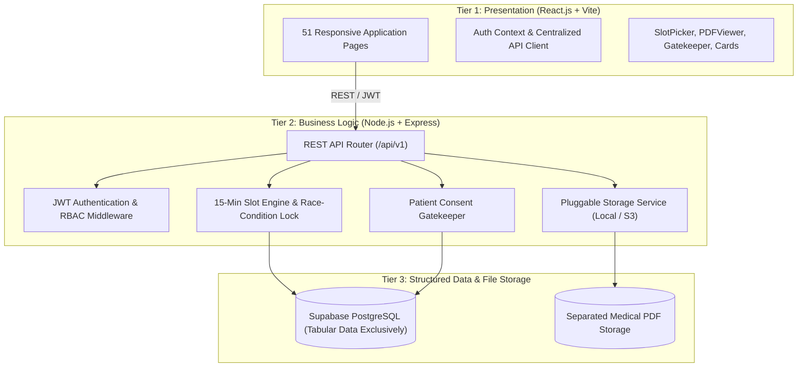

# Sushrut Healthcare Platform

A production-grade, full-stack healthcare management web application engineered with **React.js (Vite)**, **Node.js (Express.js)**, **Supabase PostgreSQL**, a pluggable private file storage abstraction, and REST APIs.

The platform provides a complete ecosystem for patients, doctors, diagnostic laboratories, and administrators, featuring:
- **BookMyShow-style 15-minute slot appointment booking** with race-condition & double-booking prevention.
- **Patient-controlled consent gatekeeper:** Doctors cannot view historical patient records without explicit, revocable patient permission.
- **Separated medical document storage:** Medical PDFs are never stored as database blobs in PostgreSQL.
- **Standardized cryptographic filenames:** Enforced naming patterns for clinical prescriptions and diagnostic lab reports.
- **Complete role-based workflows:** 51 fully implemented, interconnected React application pages.

---

## 1. System Architecture

Sushrut is architected using a clean **three-tier architecture**:



### Architecture Highlights:
- **Tier 1 (Presentation):** React 18, Vite, Tailwind CSS, Lucide icons. Never connects directly to PostgreSQL; communicates strictly via REST API with JWT Bearer tokens.
- **Tier 2 (Application):** Node.js v22 + Express 4. Modular controllers, services, repositories, validators, and middleware (Helmet, CORS, Rate-Limiting, Multer).
- **Tier 3 (Structured Data):** Supabase PostgreSQL for tabular application data (users, profiles, appointments, consent grants, audit logs).
- **File Storage:** Abstracted storage service supporting local filesystem storage for development and S3-compatible object storage (AWS S3, Cloudflare R2, MinIO) for production.

---

## 2. Project Directory Structure

```text
Sushrut/
├── frontend/                         # React 18 + Vite Frontend Application
│   ├── src/
│   │   ├── api/                      # Centralized API client (JWT Bearer injection)
│   │   ├── components/
│   │   │   ├── appointments/         # SlotPicker (BookMyShow-style 15-min intervals)
│   │   │   ├── common/               # Header, Footer, Sidebar, PDFViewer, RoleSwitcherBar
│   │   │   ├── doctors/              # DoctorCard, DoctorGrid, ReviewList
│   │   │   └── laboratory/           # LaboratoryCard, TestSelector
│   │   ├── context/                  # AuthContext (auth state, login, logout, fast switcher)
│   │   ├── layouts/                  # 6 Role layouts (Public, Auth, Patient, Doctor, Lab, Admin)
│   │   ├── pages/                    # All 51 React application pages
│   │   │   ├── public/               # 5 Public directory & profile pages
│   │   │   ├── auth/                 # 6 Authentication & registration pages
│   │   │   ├── patient/              # 13 Patient portal pages
│   │   │   ├── doctor/               # 9 Doctor clinical portal pages
│   │   │   ├── laboratory/           # 8 Diagnostic laboratory portal pages
│   │   │   └── admin/                # 10 Platform oversight & verification pages
│   │   ├── App.jsx                   # Central React Router (v6) route tree
│   │   └── main.jsx
│   ├── package.json
│   ├── vite.config.js
│   └── tailwind.config.js
├── backend/                          # Node.js + Express REST API Application
│   ├── src/
│   │   ├── config/                   # Environment configuration & constants
│   │   ├── controllers/              # HTTP request handlers for all 10 domain resources
│   │   ├── middleware/               # Auth, RBAC, Rate-limiting, Multer PDF validation, Errors
│   │   ├── repositories/             # Database repository (Supabase PostgreSQL + seeded fallback)
│   │   ├── routes/                   # REST API routes mounted at /api/v1
│   │   ├── services/                 # Business logic: Auth, Appointments, Consent, Storage
│   │   ├── storage/                  # Pluggable storage abstraction (Local & S3 adapters)
│   │   ├── utils/                    # Identifier generators & filename pattern formatters
│   │   ├── app.js                    # Express app configuration
│   │   └── server.js                 # HTTP server bootstrap
│   ├── tests/                        # Automated backend test suites
│   ├── package.json
│   └── .env.example
├── database/                         # Relational Tabular Schema & Seeds
│   ├── supabase-schema.sql           # Complete Supabase PostgreSQL schema (21 domains)
│   ├── migrations/                   # SQL migration files
│   └── seeds/                        # Realistic JSON seed datasets
├── storage/                          # Local directory for medical PDF documents
├── docs/                             # In-depth technical documentation
│   ├── architecture.md               # System architecture & sequence diagrams
│   ├── database-schema.md            # Complete tables, sequences, indexes, and constraints
│   ├── api-documentation.md          # REST API specifications (/api/v1)
│   ├── security.md                   # RBAC matrix, gatekeeper consent & compliance
│   └── setup-guide.md                # Installation, environment vars & deployment guide
├── legacy-prototype/                 # Archived vanilla static HTML prototype
└── README.md
```

---

## 3. Complete Catalog of All 51 Implemented Pages

### Category A: Public Discovery (5 Pages)
- [`HomePage`](frontend/src/pages/public/HomePage.jsx) (`/`) — Hero search, specialties, featured doctors & certified labs.
- [`FindDoctorsPage`](frontend/src/pages/public/FindDoctorsPage.jsx) (`/find-doctors`) — Doctor search with specialty, city, rating, and fee filters.
- [`DoctorProfilePage`](frontend/src/pages/public/DoctorProfilePage.jsx) (`/doctors/:doctorId`) — Doctor biography, qualifications, consultation fee, and patient reviews.
- [`FindLaboratoriesPage`](frontend/src/pages/public/FindLaboratoriesPage.jsx) (`/find-laboratories`) — Lab directory with home-collection filter.
- [`LaboratoryProfilePage`](frontend/src/pages/public/LaboratoryProfilePage.jsx) (`/laboratories/:laboratoryId`) — Diagnostic test catalog and pricing.

### Category B: Authentication & Onboarding (6 Pages)
- [`LoginPage`](frontend/src/pages/auth/LoginPage.jsx) (`/login`) — Secure sign-in with **1-Click Test Role Switcher**.
- [`RegisterPatientPage`](frontend/src/pages/auth/RegisterPatientPage.jsx) (`/register/patient`) — Patient registration form.
- [`RegisterDoctorPage`](frontend/src/pages/auth/RegisterDoctorPage.jsx) (`/register/doctor`) — Doctor onboarding with medical council registration.
- [`RegisterLaboratoryPage`](frontend/src/pages/auth/RegisterLaboratoryPage.jsx) (`/register/laboratory`) — Diagnostic lab registration with NABL details.
- [`ForgotPasswordPage`](frontend/src/pages/auth/ForgotPasswordPage.jsx) (`/forgot-password`) — Password recovery request.
- [`ResetPasswordPage`](frontend/src/pages/auth/ResetPasswordPage.jsx) (`/reset-password`) — Token-verified password reset.

### Category C: Patient Portal (13 Pages)
- [`PatientDashboardPage`](frontend/src/pages/patient/PatientDashboardPage.jsx) (`/patient/dashboard`) — Upcoming consultations, recent records, active consents.
- [`PatientDoctorSearchPage`](frontend/src/pages/patient/PatientDoctorSearchPage.jsx) (`/patient/doctors`) — Doctor search within patient dashboard.
- [`PatientDoctorDetailsPage`](frontend/src/pages/patient/PatientDoctorDetailsPage.jsx) (`/patient/doctors/:doctorId`) — Doctor profile with slot booking initiation.
- [`BookAppointmentPage`](frontend/src/pages/patient/BookAppointmentPage.jsx) (`/patient/book-appointment/:doctorId`) — **BookMyShow-style 15-minute slot picker**.
- [`AppointmentConfirmationPage`](frontend/src/pages/patient/AppointmentConfirmationPage.jsx) (`/patient/appointments/:appointmentId/confirmation`) — Booking confirmation summary.
- [`MyAppointmentsPage`](frontend/src/pages/patient/MyAppointmentsPage.jsx) (`/patient/appointments`) — Tabbed upcoming, completed, and cancelled appointments.
- [`AppointmentDetailsPage`](frontend/src/pages/patient/AppointmentDetailsPage.jsx) (`/patient/appointments/:appointmentId`) — Appointment details and status timeline.
- [`MedicalRecordsPage`](frontend/src/pages/patient/MedicalRecordsPage.jsx) (`/patient/records`) — Centralized clinical records vault.
- [`PrescriptionsPage`](frontend/src/pages/patient/PrescriptionsPage.jsx) (`/patient/prescriptions`) — Digital prescriptions with PDF viewer access.
- [`LaboratoryReportsPage`](frontend/src/pages/patient/LaboratoryReportsPage.jsx) (`/patient/laboratory-reports`) — Diagnostic reports with test results.
- [`DocumentViewerPage`](frontend/src/pages/patient/DocumentViewerPage.jsx) (`/patient/documents/:documentId`) — **Secure PDF viewer** with Zoom, Print, and Download.
- [`BookLabTestsPage`](frontend/src/pages/patient/BookLabTestsPage.jsx) (`/patient/book-lab-tests`) — Diagnostic test booking with home sample collection.
- [`PatientProfilePage`](frontend/src/pages/patient/PatientProfilePage.jsx) (`/patient/profile`) — Profile management and **Doctor Access Consent Controls**.

### Category D: Doctor Portal (9 Pages)
- [`DoctorDashboardPage`](frontend/src/pages/doctor/DoctorDashboardPage.jsx) (`/doctor/dashboard`) — Queue overview, metrics, and pending access requests.
- [`TodayAppointmentsPage`](frontend/src/pages/doctor/TodayAppointmentsPage.jsx) (`/doctor/appointments/today`) — Daily consultation queue with consent status.
- [`AppointmentCalendarPage`](frontend/src/pages/doctor/AppointmentCalendarPage.jsx) (`/doctor/calendar`) — Monthly consultation calendar view.
- [`ManageAvailabilityPage`](frontend/src/pages/doctor/ManageAvailabilityPage.jsx) (`/doctor/availability`) — **Weekly availability & 15-minute slot generator**.
- [`DoctorAppointmentDetailsPage`](frontend/src/pages/doctor/DoctorAppointmentDetailsPage.jsx) (`/doctor/appointments/:appointmentId`) — Consultation workspace with consent gating.
- [`PatientAccessRequestsPage`](frontend/src/pages/doctor/PatientAccessRequestsPage.jsx) (`/doctor/access-requests`) — Tracker for requested patient medical records.
- [`PatientMedicalRecordsPage`](frontend/src/pages/doctor/PatientMedicalRecordsPage.jsx) (`/doctor/patients/:patientId/records`) — Gated patient historical records view.
- [`DiagnosisPrescriptionPage`](frontend/src/pages/doctor/DiagnosisPrescriptionPage.jsx) (`/doctor/diagnosis-prescription`) — Clinical diagnosis & prescription generator.
- [`DoctorOwnProfilePage`](frontend/src/pages/doctor/DoctorProfilePage.jsx) (`/doctor/profile`) — Doctor biography, clinic address, and fee settings.

### Category E: Laboratory Portal (8 Pages)
- [`LaboratoryDashboardPage`](frontend/src/pages/laboratory/LaboratoryDashboardPage.jsx) (`/laboratory/dashboard`) — Daily sample queue and turnaround metrics.
- [`ManageServicesPage`](frontend/src/pages/laboratory/ManageServicesPage.jsx) (`/laboratory/services`) — Test catalog offerings and pricing manager.
- [`TestBookingsPage`](frontend/src/pages/laboratory/TestBookingsPage.jsx) (`/laboratory/bookings`) — Incoming orders with collection status filters.
- [`LaboratoryBookingDetailsPage`](frontend/src/pages/laboratory/LaboratoryBookingDetailsPage.jsx) (`/laboratory/bookings/:bookingId`) — Sample tracking & collection dispatch.
- [`UploadReportPage`](frontend/src/pages/laboratory/UploadReportPage.jsx) (`/laboratory/upload-report`) — Certified PDF report upload.
- [`ReportHistoryPage`](frontend/src/pages/laboratory/ReportHistoryPage.jsx) (`/laboratory/reports`) — Completed diagnostic report archive.
- [`LaboratorySettingsPage`](frontend/src/pages/laboratory/LaboratorySettingsPage.jsx) (`/laboratory/settings`) — Operational hours and pickup settings.
- [`LaboratoryOwnProfilePage`](frontend/src/pages/laboratory/LaboratoryProfilePage.jsx) (`/laboratory/profile`) — Laboratory profile & NABL information.

### Category F: Administrator Portal (10 Pages)
- [`AdminDashboardPage`](frontend/src/pages/admin/AdminDashboardPage.jsx) (`/admin/dashboard`) — Platform statistics, user counts, and pending actions.
- [`PendingDoctorsPage`](frontend/src/pages/admin/PendingDoctorsPage.jsx) (`/admin/doctors/pending`) — Doctor credential review queue.
- [`DoctorVerificationPage`](frontend/src/pages/admin/DoctorVerificationPage.jsx) (`/admin/doctors/:doctorId/verify`) — Credential inspection & approval decision.
- [`PendingLaboratoriesPage`](frontend/src/pages/admin/PendingLaboratoriesPage.jsx) (`/admin/laboratories/pending`) — Laboratory accreditation review queue.
- [`LaboratoryVerificationPage`](frontend/src/pages/admin/LaboratoryVerificationPage.jsx) (`/admin/laboratories/:laboratoryId/verify`) — NABL accreditation review & decision.
- [`PatientManagementPage`](frontend/src/pages/admin/PatientManagementPage.jsx) (`/admin/patients`) — Patient directory and account status oversight.
- [`DoctorManagementPage`](frontend/src/pages/admin/DoctorManagementPage.jsx) (`/admin/doctors`) — Doctor directory with active status toggles.
- [`LaboratoryManagementPage`](frontend/src/pages/admin/LaboratoryManagementPage.jsx) (`/admin/laboratories`) — Diagnostic lab directory.
- [`AppointmentOversightPage`](frontend/src/pages/admin/AppointmentOversightPage.jsx) (`/admin/appointments`) — Platform-wide appointment oversight.
- [`AdminSettingsAuditLogsPage`](frontend/src/pages/admin/AdminSettingsAuditLogsPage.jsx) (`/admin/audit-logs`) — Platform audit trails (**Zero access to clinical PDFs**).

---

## 4. Key Engineering Implementations

### 4.1 Standardized Identifier Sequences & Filenames

All identifiers and filenames follow strict specifications:

| Entity | Identifier Format | Example |
| :--- | :--- | :--- |
| **Patient** | `PAI` + 6 digits | `PAI100001` |
| **Doctor** | `DOC` + 6 digits | `DOC100001` |
| **Laboratory** | `LAB` + 6 digits | `LAB100001` |
| **Diagnostic Test** | `TST` + 6 digits | `TST000001` |
| **Disease / Diagnosis** | `DIS` + 6 digits | `DIS000001` |
| **Record / Report** | `RPT` + 6 digits | `RPT000001` |

#### Enforced Filename Patterns:
- **Laboratory Report:** `PATIENT_ID-TEST_ID-LAB_ID-REPORT_ID.pdf`  
  *Example:* `PAI100001-TST000001-LAB100001-RPT000001.pdf`
- **Clinical Prescription:** `PATIENT_ID-DISEASE_ID-DOCTOR_ID-RECORD_ID.pdf`  
  *Example:* `PAI100001-DIS000001-DOC100001-RPT000001.pdf`

---

### 4.2 Patient Consent Gatekeeper

Historical clinical records are inaccessible to doctors by default.
1. Doctor requests record access with clinical justification.
2. Patient receives in-app alert and grants or denies access.
3. Upon approval, an active grant is created in `patient_access_grants`.
4. Patient can revoke access at any time, instantly cutting off further access.
5. All access attempts are recorded in `patient_access_audit_logs`.

---

### 4.3 15-Minute Slot Engine & Concurrency Locking

- Doctors configure weekly working hours and default slot duration (15 minutes).
- Concurrency race conditions are prevented via a PostgreSQL unique index:
  ```sql
  CREATE UNIQUE INDEX idx_no_double_booking 
  ON appointments(doctor_id, appointment_date, start_time) 
  WHERE status NOT IN ('cancelled');
  ```
- Attempting to double-book a slot immediately returns `409 Conflict`.

---

## 5. Quickstart & Local Setup

### 5.1 Prerequisites
- Node.js v18+ (v20+ or v22 recommended)
- npm v9+

### 5.2 Start the Backend
```bash
cd backend
npm install
npm test            # Run automated tests (7/7 passed)
npm run dev         # Starts backend API on http://localhost:5000/api/v1
```

### 5.3 Start the Frontend
```bash
cd frontend
npm install
npm run build       # Verify production compilation
npm run dev         # Starts Vite dev server on http://localhost:5173
```

---

## 6. Pre-Seeded Demo Credentials

| Role | Email | Password | Details |
| :--- | :--- | :--- | :--- |
| **Patient** | `patient@sushrut.com` | `Password123!` | Aarav Sharma (`PAI100001`) |
| **Doctor** | `doctor@sushrut.com` | `Password123!` | Dr. Rajesh Mehta (`DOC100001`) |
| **Laboratory** | `lab@sushrut.com` | `Password123!` | Apex Diagnostic Centre (`LAB100001`) |
| **Administrator** | `admin@sushrut.com` | `Password123!` | Platform Administrator |

> **Development Convenience:** The sticky top banner in the frontend allows instant 1-click role switching between Patient, Doctor, Laboratory, and Admin accounts without manual re-login.

---

## 7. Technical Documentation Links

For comprehensive architectural and implementation details, refer to the documentation suite in `docs/`:

- [System Architecture Documentation](docs/architecture.md)
- [Database Schema & Entity Specifications](docs/database-schema.md)
- [REST API Reference (/api/v1)](docs/api-documentation.md)
- [Security, RBAC & Gatekeeper Architecture](docs/security.md)
- [Setup & Deployment Guide](docs/setup-guide.md)

---

## 8. License & Boundaries

This project represents the healthcare management and appointment system of the Sushrut initiative. It is strictly separated from the future Sushrut Digital Twin project and contains no digital twin simulations, ONNX inference engines, or HbA1c ML models.

