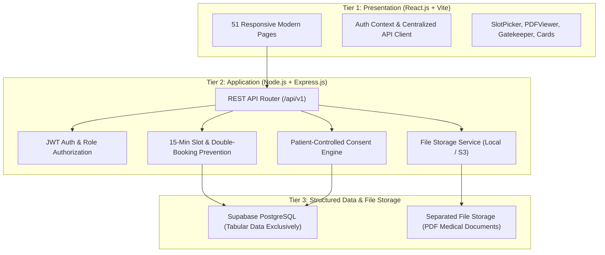

# Sushrut Healthcare Platform - Architecture Documentation

## 1. System Overview & Three-Tier Architecture

The **Sushrut Healthcare Platform** is designed as a secure, three-tier healthcare management platform:

### 1.1 Tier 1: Presentation Layer
- **Framework:** React.js 18 built with Vite.
- **Routing:** React Router DOM v6 with role-specific layout wrappers (`PublicLayout`, `AuthLayout`, `PatientLayout`, `DoctorLayout`, `LaboratoryLayout`, `AdminLayout`).
- **Styling:** Modern Tailwind CSS with healthcare teal/emerald/slate design tokens.
- **Data Fetching:** Centralized API client (`src/api/client.js`) injecting JWT Bearer tokens and handling errors.
- **Security Rule:** The frontend never connects directly to PostgreSQL and never contains database passwords, private keys, or service-role credentials.

### 1.2 Tier 2: Application & Business Logic Layer
- **Runtime:** Node.js v22.
- **Framework:** Express.js 4.
- **Architecture:** Layered controllers, services, repositories, validators, and middleware.
- **Security Headers & Protection:** Helmet, CORS allowlisting, Rate limiting (`express-rate-limit`), Multer PDF validation, and centralized error handling.
- **Identities:** Derived strictly on the backend from verified JWT authentication tokens.

### 1.3 Tier 3: Structured Data & Separated File Storage
- **Tabular Database:** Supabase PostgreSQL used exclusively for structured application data (users, profiles, slots, bookings, consent grants, audit logs).
- **Separated File Storage:** Medical PDF files are **never stored as database Blobs or Base64** in PostgreSQL. They are stored in external filesystem/S3 object storage, referenced only by metadata, storage keys, and SHA-256 checksums.

---

## 2. Identifier Sequences & Required Filename Patterns

### 2.1 Identifiers
- Patient ID: `PAI` + numeric sequence (e.g. `PAI100001`)
- Doctor ID: `DOC` + numeric sequence (e.g. `DOC100001`)
- Laboratory ID: `LAB` + numeric sequence (e.g. `LAB100001`)
- Test ID: `TST` + numeric sequence (e.g. `TST000001`)
- Disease ID: `DIS` + numeric sequence (e.g. `DIS000001`)
- Report / Record ID: `RPT` + numeric sequence (e.g. `RPT000001`)

### 2.2 Filename Patterns
- **Laboratory Report Filename Pattern:**
  `PATIENT_ID-TEST_ID-LAB_ID-REPORT_ID.pdf`
  *Example:* `PAI100001-TST000001-LAB100001-RPT000001.pdf`

- **Prescription Filename Pattern:**
  `PATIENT_ID-DISEASE_ID-DOCTOR_ID-RECORD_ID.pdf`
  *Example:* `PAI100001-DIS000001-DOC100001-RPT000001.pdf`

---

## 3. Core Workflows

### 3.1 Patient-Controlled Gatekeeper Consent
1. A doctor viewing an appointment does not automatically receive access to historical records.
2. The doctor requests access specifying clinical purpose (`ConsentService.requestAccess`).
3. The patient receives an in-app notification and reviews the request.
4. The patient approves or denies. Upon approval, an active grant is created in `patient_access_grants`.
5. The doctor can access clinical records only while the grant is active.
6. The patient can revoke access at any time with immediate server-enforced denial.

### 3.2 15-Minute Slot Engine & Double-Booking Prevention
1. Doctors define recurring weekly availability rules and slot durations (default 15 minutes).
2. The slot engine generates non-conflicting time windows.
3. Upon booking submission, the backend checks for existing active bookings on the same `(doctor_id, appointment_date, start_time)`.
4. An atomic operation locks the slot. If another patient reserved the slot simultaneously, a `409 Conflict` error is returned.
