# Sushrut Healthcare Platform - Database Schema Documentation

## 1. Overview & Architecture Principles

The **Sushrut Healthcare Platform** uses **Supabase PostgreSQL** exclusively for structured, tabular application data.

### Strict Storage Separation Principle
- **No Binary Blobs in PostgreSQL:** Uploaded PDF documents (such as clinical prescriptions and diagnostic laboratory reports) are **never** stored as `BYTEA`, `BLOB`, or Base64 encoded text within database tables.
- **Metadata Storage in PostgreSQL:** The database stores document metadata, generated standardized filenames, storage path references, MIME types, file sizes in bytes, SHA-256 checksums, and audit timestamps.
- **Physical File Storage:** The actual PDF binary streams reside in an external file storage system (local filesystem storage adapter in development; S3-compatible private object storage adapter in production).

---

## 2. Entity-Relationship Overview

```mermaid
erDiagram
    USERS ||--o| PATIENTS : "1-to-1 profile"
    USERS ||--o| DOCTORS : "1-to-1 profile"
    USERS ||--o| LABORATORIES : "1-to-1 profile"
    USERS ||--o{ REFRESH_TOKENS : "owns"
    USERS ||--o{ NOTIFICATIONS : "receives"
    USERS ||--o{ AUDIT_LOGS : "triggers"

    SPECIALTIES ||--o{ DOCTORS : "primary specialty"
    SPECIALTIES ||--o{ DOCTOR_SPECIALTIES : "categorizes"
    DOCTORS ||--o{ DOCTOR_SPECIALTIES : "possesses"
    DOCTORS ||--o{ DOCTOR_AVAILABILITY : "configures"
    DOCTORS ||--o{ DOCTOR_AVAILABILITY_EXCEPTIONS : "has"

    PATIENTS ||--o{ APPOINTMENTS : "books"
    DOCTORS ||--o{ APPOINTMENTS : "attends"
    APPOINTMENTS ||--o| DOCTOR_REVIEWS : "reviewed in"

    LABORATORIES ||--o{ LABORATORY_OFFERINGS : "provides"
    TEST_CATALOGUE ||--o{ LABORATORY_OFFERINGS : "defines"
    PATIENTS ||--o{ LABORATORY_BOOKINGS : "schedules"
    LABORATORIES ||--o{ LABORATORY_BOOKINGS : "processes"
    TEST_CATALOGUE ||--o{ LABORATORY_BOOKINGS : "specifies"

    DISEASES_CATALOGUE ||--o{ DIAGNOSES : "classifies"
    PATIENTS ||--o{ DIAGNOSES : "diagnosed for"
    DOCTORS ||--o{ DIAGNOSES : "diagnoses"

    PATIENTS ||--o{ PRESCRIPTIONS : "prescribed to"
    DOCTORS ||--o{ PRESCRIPTIONS : "issued by"
    DISEASES_CATALOGUE ||--o{ PRESCRIPTIONS : "targets"
    APPOINTMENTS ||--o| PRESCRIPTIONS : "generated during"

    PATIENTS ||--o{ LABORATORY_REPORTS : "belongs to"
    LABORATORIES ||--o{ LABORATORY_REPORTS : "uploaded by"
    TEST_CATALOGUE ||--o{ LABORATORY_REPORTS : "analyzes"

    PATIENTS ||--o{ PATIENT_ACCESS_REQUESTS : "requested from"
    DOCTORS ||--o{ PATIENT_ACCESS_REQUESTS : "requests"
    PATIENTS ||--o{ PATIENT_ACCESS_GRANTS : "consents to"
    DOCTORS ||--o{ PATIENT_ACCESS_GRANTS : "granted to"
    PATIENTS ||--o{ PATIENT_ACCESS_AUDIT_LOGS : "logs events for"
```



---

## 3. Identifier Sequences & Format Rules

All domain entity identifiers follow strict standardized sequential alphanumeric codes:

| Entity | Sequence Name | Start Value | Identifier Format | Example |
| :--- | :--- | :--- | :--- | :--- |
| **Patient** | `seq_patient_id` | `100001` | `PAI` + 6 digits | `PAI100001` |
| **Doctor** | `seq_doctor_id` | `100001` | `DOC` + 6 digits | `DOC100001` |
| **Laboratory** | `seq_laboratory_id` | `100001` | `LAB` + 6 digits | `LAB100001` |
| **Lab Test** | `seq_test_id` | `1` | `TST` + 6 digits | `TST000001` |
| **Disease / Diagnosis** | `seq_disease_id` | `1` | `DIS` + 6 digits | `DIS000001` |
| **Medical Report / Record** | `seq_report_id` | `1` | `RPT` + 6 digits | `RPT000001` |
| **Doctor Appointment** | `seq_appointment_id`| `1001` | `APT` + 4+ digits | `APT1001` |
| **Laboratory Booking** | `seq_lab_booking_id` | `5001` | `LBD` + 4+ digits | `LBD5001` |

---

## 4. Complete Table Specifications

### 4.1 Authentication & Accounts

#### `users`
Core user identity credentials and authorization roles.
- `id` (UUID, Primary Key, Default: `uuid_generate_v4()`)
- `email` (VARCHAR(255), Unique, Not Null)
- `password_hash` (VARCHAR(255), Not Null) - Bcrypt hashed password
- `role` (VARCHAR(50), Not Null, CHECK: `role IN ('patient', 'doctor', 'laboratory', 'admin')`)
- `is_active` (BOOLEAN, Default: `true`)
- `email_verified` (BOOLEAN, Default: `true`)
- `verification_token` (VARCHAR(255))
- `reset_password_token` (VARCHAR(255))
- `reset_password_expires_at` (TIMESTAMPTZ)
- `last_login_at` (TIMESTAMPTZ)
- `created_at` (TIMESTAMPTZ, Default: `NOW()`)
- `updated_at` (TIMESTAMPTZ, Default: `NOW()`)
- *Indexes:* `idx_users_email` (email), `idx_users_role` (role)

#### `refresh_tokens`
Long-lived session tokens allowing instant server-side revocation.
- `id` (UUID, Primary Key)
- `user_id` (UUID, Foreign Key -> `users.id` ON DELETE CASCADE)
- `token_hash` (VARCHAR(255), Unique, Not Null)
- `expires_at` (TIMESTAMPTZ, Not Null)
- `revoked` (BOOLEAN, Default: `false`)
- `created_at` (TIMESTAMPTZ, Default: `NOW()`)

---

### 4.2 Medical Specialties

#### `specialties`
Standardized clinical medicine disciplines.
- `id` (UUID, Primary Key)
- `name` (VARCHAR(100), Unique, Not Null) - e.g., "Endocrinology & Diabetology", "Cardiology"
- `slug` (VARCHAR(100), Unique, Not Null)
- `description` (TEXT)
- `icon` (VARCHAR(100))
- `is_active` (BOOLEAN, Default: `true`)
- `created_at` (TIMESTAMPTZ, Default: `NOW()`)

---

### 4.3 Patient Profiles

#### `patients`
Demographic and emergency medical contact information.
- `id` (UUID, Primary Key)
- `patient_id` (VARCHAR(30), Unique, Not Null) - Format: `PAI100001`
- `user_id` (UUID, Unique, Foreign Key -> `users.id` ON DELETE CASCADE)
- `full_name` (VARCHAR(150), Not Null)
- `phone` (VARCHAR(30))
- `dob` (DATE)
- `gender` (VARCHAR(20), CHECK: `gender IN ('Male', 'Female', 'Other', 'Prefer not to say')`)
- `blood_group` (VARCHAR(10)) - e.g., "O+", "A+"
- `address` (TEXT)
- `city` (VARCHAR(100))
- `state` (VARCHAR(100))
- `postal_code` (VARCHAR(20))
- `emergency_contact_name` (VARCHAR(150))
- `emergency_contact_phone` (VARCHAR(30))
- `allergies` (TEXT)
- `chronic_conditions` (TEXT)
- `created_at` (TIMESTAMPTZ, Default: `NOW()`)
- `updated_at` (TIMESTAMPTZ, Default: `NOW()`)
- *Indexes:* `idx_patients_patient_id`, `idx_patients_user_id`

---

### 4.4 Doctor Profiles & Availability

#### `doctors`
Professional credentials, clinic coordinates, verification status, and ratings.
- `id` (UUID, Primary Key)
- `doctor_id` (VARCHAR(30), Unique, Not Null) - Format: `DOC100001`
- `user_id` (UUID, Unique, Foreign Key -> `users.id` ON DELETE CASCADE)
- `full_name` (VARCHAR(150), Not Null)
- `phone` (VARCHAR(30))
- `primary_specialty_id` (UUID, Foreign Key -> `specialties.id`)
- `qualifications` (VARCHAR(255), Not Null) - e.g., "MBBS, MD, DM"
- `registration_number` (VARCHAR(100), Not Null) - Medical council reg.
- `experience_years` (INT, Default: `0`)
- `consultation_fee` (NUMERIC(10,2), Default: `500.00`)
- `clinic_name` (VARCHAR(200), Not Null)
- `clinic_address` (TEXT, Not Null)
- `city` (VARCHAR(100), Not Null)
- `latitude` (NUMERIC(10, 6)), `longitude` (NUMERIC(10, 6))
- `bio` (TEXT)
- `profile_image_url` (TEXT)
- `verification_status` (VARCHAR(30), Default: `'pending'`, CHECK: `IN ('pending', 'approved', 'rejected')`)
- `verification_notes` (TEXT)
- `verification_documents` (JSONB, Default: `'[]'`)
- `approved_at` (TIMESTAMPTZ), `approved_by` (UUID -> `users.id`)
- `rating_avg` (NUMERIC(3, 1), Default: `9.5`)
- `total_reviews` (INT, Default: `0`)
- `created_at` (TIMESTAMPTZ, Default: `NOW()`)
- `updated_at` (TIMESTAMPTZ, Default: `NOW()`)
- *Indexes:* `idx_doctors_doctor_id`, `idx_doctors_specialty`, `idx_doctors_status`, `idx_doctors_city`

#### `doctor_specialties`
Junction table supporting secondary and sub-specialties.
- `doctor_id` (UUID, Foreign Key -> `doctors.id` ON DELETE CASCADE)
- `specialty_id` (UUID, Foreign Key -> `specialties.id` ON DELETE CASCADE)
- *Primary Key:* `(doctor_id, specialty_id)`

#### `doctor_availability`
Weekly recurring availability templates and slot intervals.
- `id` (UUID, Primary Key)
- `doctor_id` (UUID, Foreign Key -> `doctors.id` ON DELETE CASCADE)
- `day_of_week` (INT, CHECK: `0 <= day_of_week <= 6`) - 0=Sunday, 1=Monday...
- `start_time` (TIME, Not Null)
- `end_time` (TIME, Not Null)
- `slot_duration_minutes` (INT, Default: `15`, CHECK: `IN (10, 15, 20, 30, 45, 60)`)
- `is_active` (BOOLEAN, Default: `true`)
- `created_at` (TIMESTAMPTZ, Default: `NOW()`)
- *Constraints:* `chk_doctor_avail_time (start_time < end_time)`

#### `doctor_availability_exceptions`
Date-specific holidays, leaves, or supplemental consultation hours.
- `id` (UUID, Primary Key)
- `doctor_id` (UUID, Foreign Key -> `doctors.id` ON DELETE CASCADE)
- `exception_date` (DATE, Not Null)
- `start_time` (TIME), `end_time` (TIME)
- `is_unavailable` (BOOLEAN, Default: `true`)
- `reason` (VARCHAR(255))
- `created_at` (TIMESTAMPTZ, Default: `NOW()`)

---

### 4.5 Laboratory Profiles & Test Catalogue

#### `laboratories`
Diagnostic centre information, NABL accreditation, and home-collection capabilities.
- `id` (UUID, Primary Key)
- `lab_id` (VARCHAR(30), Unique, Not Null) - Format: `LAB100001`
- `user_id` (UUID, Unique, Foreign Key -> `users.id` ON DELETE CASCADE)
- `name` (VARCHAR(200), Not Null)
- `phone` (VARCHAR(30), Not Null)
- `email` (VARCHAR(255), Not Null)
- `address` (TEXT, Not Null)
- `city` (VARCHAR(100), Not Null)
- `state` (VARCHAR(100)), `postal_code` (VARCHAR(20))
- `latitude` (NUMERIC(10, 6)), `longitude` (NUMERIC(10, 6))
- `nabl_accreditation_number` (VARCHAR(100))
- `verification_status` (VARCHAR(30), Default: `'pending'`, CHECK: `IN ('pending', 'approved', 'rejected')`)
- `verification_notes` (TEXT)
- `verification_documents` (JSONB, Default: `'[]'`)
- `approved_at` (TIMESTAMPTZ), `approved_by` (UUID -> `users.id`)
- `provides_home_collection` (BOOLEAN, Default: `true`)
- `home_collection_fee` (NUMERIC(10,2), Default: `150.00`)
- `operating_hours` (VARCHAR(150), Default: `'8:00 AM - 8:00 PM'`)
- `description` (TEXT)
- `created_at` (TIMESTAMPTZ, Default: `NOW()`)
- `updated_at` (TIMESTAMPTZ, Default: `NOW()`)

#### `test_catalogue`
Standardized clinical investigation master catalogue.
- `id` (UUID, Primary Key)
- `test_id` (VARCHAR(30), Unique, Not Null) - Format: `TST000001`
- `name` (VARCHAR(200), Not Null) - e.g., "Comprehensive Metabolic Panel"
- `category` (VARCHAR(100), Not Null) - e.g., "Biochemistry", "Hematology"
- `description` (TEXT)
- `sample_type` (VARCHAR(100), Not Null) - e.g., "Blood", "Serum", "Urine"
- `fasting_required` (BOOLEAN, Default: `false`)
- `preparation_instructions` (TEXT)
- `default_price` (NUMERIC(10,2), Default: `500.00`)
- `turnaround_time_hours` (INT, Default: `24`)
- `is_active` (BOOLEAN, Default: `true`)
- `created_at` (TIMESTAMPTZ, Default: `NOW()`)

#### `laboratory_offerings`
Lab-specific pricing and availability overrides.
- `id` (UUID, Primary Key)
- `lab_id` (UUID, Foreign Key -> `laboratories.id` ON DELETE CASCADE)
- `test_id` (UUID, Foreign Key -> `test_catalogue.id` ON DELETE CASCADE)
- `price` (NUMERIC(10,2), Not Null)
- `is_available` (BOOLEAN, Default: `true`)
- `home_collection_available` (BOOLEAN, Default: `true`)
- `created_at` (TIMESTAMPTZ, Default: `NOW()`)
- *Unique Constraint:* `UNIQUE (lab_id, test_id)`

---

### 4.6 Appointments & Laboratory Bookings

#### `appointments`
Scheduled doctor consultations with concurrency protection.
- `id` (UUID, Primary Key)
- `appointment_id` (VARCHAR(30), Unique, Not Null) - Format: `APT1001`
- `patient_id` (UUID, Foreign Key -> `patients.id` ON DELETE CASCADE)
- `doctor_id` (UUID, Foreign Key -> `doctors.id` ON DELETE CASCADE)
- `appointment_date` (DATE, Not Null)
- `start_time` (TIME, Not Null)
- `end_time` (TIME, Not Null)
- `status` (VARCHAR(30), Default: `'confirmed'`, CHECK: `IN ('pending', 'confirmed', 'completed', 'cancelled', 'no_show')`)
- `consultation_type` (VARCHAR(30), Default: `'in_person'`, CHECK: `IN ('in_person', 'video')`)
- `fee` (NUMERIC(10,2), Not Null)
- `symptoms` (TEXT)
- `cancellation_reason` (TEXT)
- `cancelled_at` (TIMESTAMPTZ), `cancelled_by` (UUID -> `users.id`)
- `created_at` (TIMESTAMPTZ, Default: `NOW()`)
- `updated_at` (TIMESTAMPTZ, Default: `NOW()`)
- **Double-Booking Prevention Index:**
  ```sql
  CREATE UNIQUE INDEX idx_no_double_booking 
  ON appointments(doctor_id, appointment_date, start_time) 
  WHERE status NOT IN ('cancelled');
  ```

#### `laboratory_bookings`
Diagnostic sample appointments and home pickup dispatch.
- `id` (UUID, Primary Key)
- `booking_id` (VARCHAR(30), Unique, Not Null) - Format: `LBD5001`
- `patient_id` (UUID, Foreign Key -> `patients.id` ON DELETE CASCADE)
- `lab_id` (UUID, Foreign Key -> `laboratories.id` ON DELETE CASCADE)
- `test_id` (UUID, Foreign Key -> `test_catalogue.id` ON DELETE CASCADE)
- `booking_date` (DATE, Not Null)
- `preferred_time_slot` (VARCHAR(50), Not Null)
- `collection_type` (VARCHAR(30), Default: `'lab_visit'`, CHECK: `IN ('lab_visit', 'home_collection')`)
- `collection_address` (TEXT), `collection_city` (VARCHAR(100)), `collection_postal_code` (VARCHAR(20))
- `status` (VARCHAR(30), Default: `'confirmed'`, CHECK: `IN ('pending', 'confirmed', 'sample_collected', 'processing', 'completed', 'cancelled')`)
- `total_amount` (NUMERIC(10,2), Not Null)
- `cancellation_reason` (TEXT)
- `created_at` (TIMESTAMPTZ, Default: `NOW()`)
- `updated_at` (TIMESTAMPTZ, Default: `NOW()`)

---

### 4.7 Clinical Data & Document Metadata

#### `diseases_catalogue`
- `id` (UUID, Primary Key)
- `disease_id` (VARCHAR(30), Unique, Not Null) - Format: `DIS000001`
- `code` (VARCHAR(50)) - ICD-10 or clinical code
- `name` (VARCHAR(200), Not Null)
- `description` (TEXT)
- `category` (VARCHAR(100))
- `created_at` (TIMESTAMPTZ, Default: `NOW()`)

#### `diagnoses`
- `id` (UUID, Primary Key)
- `diagnosis_id` (VARCHAR(30), Unique, Not Null)
- `appointment_id` (UUID, Foreign Key -> `appointments.id` ON DELETE SET NULL)
- `patient_id` (UUID, Foreign Key -> `patients.id` ON DELETE CASCADE)
- `doctor_id` (UUID, Foreign Key -> `doctors.id` ON DELETE CASCADE)
- `disease_id` (UUID, Foreign Key -> `diseases_catalogue.id` ON DELETE SET NULL)
- `diagnosis_text` (TEXT, Not Null)
- `clinical_notes` (TEXT)
- `diagnosed_at` (TIMESTAMPTZ, Default: `NOW()`)
- `created_at` (TIMESTAMPTZ, Default: `NOW()`)

#### `prescriptions`
Prescription metadata and file pointers.
- `id` (UUID, Primary Key)
- `prescription_id` (VARCHAR(30), Unique, Not Null)
- `record_id` (VARCHAR(30), Not Null) - Format: `RPT000001`
- `appointment_id` (UUID, Foreign Key -> `appointments.id` ON DELETE SET NULL)
- `patient_id` (UUID, Foreign Key -> `patients.id` ON DELETE CASCADE)
- `doctor_id` (UUID, Foreign Key -> `doctors.id` ON DELETE CASCADE)
- `disease_id` (UUID, Foreign Key -> `diseases_catalogue.id` ON DELETE SET NULL)
- `diagnosis_id` (UUID, Foreign Key -> `diagnoses.id` ON DELETE SET NULL)
- `medications` (JSONB, Not Null, Default: `'[]'`)
- `dosage_instructions` (TEXT), `dietary_advice` (TEXT), `follow_up_date` (DATE)
- `pdf_filename` (VARCHAR(255), Not Null) - **Enforces:** `PATIENT_ID-DISEASE_ID-DOCTOR_ID-RECORD_ID.pdf`
- `pdf_storage_path` (VARCHAR(500), Not Null)
- `file_size_bytes` (INT), `mime_type` (VARCHAR(100), Default: `'application/pdf'`)
- `checksum_sha256` (VARCHAR(64))
- `created_at` (TIMESTAMPTZ, Default: `NOW()`)
- `updated_at` (TIMESTAMPTZ, Default: `NOW()`)

#### `laboratory_reports`
Diagnostic test report metadata and file pointers.
- `id` (UUID, Primary Key)
- `report_id` (VARCHAR(30), Unique, Not Null) - Format: `RPT000001`
- `lab_booking_id` (UUID, Foreign Key -> `laboratory_bookings.id` ON DELETE SET NULL)
- `patient_id` (UUID, Foreign Key -> `patients.id` ON DELETE CASCADE)
- `lab_id` (UUID, Foreign Key -> `laboratories.id` ON DELETE CASCADE)
- `test_id` (UUID, Foreign Key -> `test_catalogue.id` ON DELETE CASCADE)
- `report_title` (VARCHAR(255), Not Null)
- `description` (TEXT)
- `report_date` (DATE, Default: `CURRENT_DATE`)
- `test_results` (JSONB, Default: `'{}'`)
- `status` (VARCHAR(30), Default: `'Normal'`, CHECK: `IN ('Normal', 'Abnormal', 'Critical', 'Pending Review')`)
- `pdf_filename` (VARCHAR(255), Not Null) - **Enforces:** `PATIENT_ID-TEST_ID-LAB_ID-REPORT_ID.pdf`
- `pdf_storage_path` (VARCHAR(500), Not Null)
- `file_size_bytes` (INT), `mime_type` (VARCHAR(100), Default: `'application/pdf'`)
- `checksum_sha256` (VARCHAR(64))
- `is_corrected` (BOOLEAN, Default: `false`), `correction_reason` (TEXT), `corrected_at` (TIMESTAMPTZ)
- `created_at` (TIMESTAMPTZ, Default: `NOW()`)
- `updated_at` (TIMESTAMPTZ, Default: `NOW()`)

---

### 4.8 Patient Consent & Permission Gatekeeper

#### `patient_access_requests`
Explicit record requests initiated by doctors.
- `id` (UUID, Primary Key)
- `request_id` (VARCHAR(30), Unique, Not Null)
- `doctor_id` (UUID, Foreign Key -> `doctors.id` ON DELETE CASCADE)
- `patient_id` (UUID, Foreign Key -> `patients.id` ON DELETE CASCADE)
- `appointment_id` (UUID, Foreign Key -> `appointments.id` ON DELETE SET NULL)
- `purpose` (TEXT, Not Null)
- `requested_scope` (VARCHAR(50), Default: `'all_records'`, CHECK: `IN ('all_records', 'prescriptions_only', 'lab_reports_only', 'single_appointment')`)
- `status` (VARCHAR(30), Default: `'pending'`, CHECK: `IN ('pending', 'approved', 'rejected', 'expired')`)
- `requested_at` (TIMESTAMPTZ, Default: `NOW()`), `responded_at` (TIMESTAMPTZ)
- `created_at` (TIMESTAMPTZ, Default: `NOW()`)

#### `patient_access_grants`
Active patient consents permitting doctor access.
- `id` (UUID, Primary Key)
- `grant_id` (VARCHAR(30), Unique, Not Null)
- `request_id` (UUID, Foreign Key -> `patient_access_requests.id` ON DELETE SET NULL)
- `doctor_id` (UUID, Foreign Key -> `doctors.id` ON DELETE CASCADE)
- `patient_id` (UUID, Foreign Key -> `patients.id` ON DELETE CASCADE)
- `scope` (VARCHAR(50), Default: `'all_records'`, CHECK: `IN ('all_records', 'prescriptions_only', 'lab_reports_only', 'single_appointment')`)
- `status` (VARCHAR(30), Default: `'active'`, CHECK: `IN ('active', 'revoked', 'expired')`)
- `granted_at` (TIMESTAMPTZ, Default: `NOW()`), `expires_at` (TIMESTAMPTZ)
- `revoked_at` (TIMESTAMPTZ), `revocation_reason` (TEXT)
- `created_at` (TIMESTAMPTZ, Default: `NOW()`), `updated_at` (TIMESTAMPTZ, Default: `NOW()`)
- *Index:* `idx_access_grants_lookup (doctor_id, patient_id, status)`

#### `patient_access_audit_logs`
Immutable compliance audit trails of all sensitive medical record views, downloads, and grants.
- `id` (UUID, Primary Key)
- `patient_id` (UUID, Foreign Key -> `patients.id` ON DELETE CASCADE)
- `accessed_by_user_id` (UUID, Foreign Key -> `users.id` ON DELETE CASCADE)
- `accessor_role` (VARCHAR(50), Not Null)
- `action` (VARCHAR(100), Not Null) - e.g., `'record_viewed'`, `'pdf_downloaded'`, `'revoked'`
- `resource_type` (VARCHAR(100), Not Null) - e.g., `'medical_records'`, `'prescription'`, `'lab_report'`
- `resource_id` (VARCHAR(100)), `ip_address` (VARCHAR(45))
- `outcome` (VARCHAR(30), Default: `'allowed'`, CHECK: `IN ('allowed', 'denied')`)
- `denial_reason` (TEXT)
- `created_at` (TIMESTAMPTZ, Default: `NOW()`)

---

### 4.9 Reviews, Notifications & Platform Audit

#### `doctor_reviews`
Post-consultation ratings on a 1-10 scale.
- `id` (UUID, Primary Key)
- `appointment_id` (UUID, Unique, Foreign Key -> `appointments.id` ON DELETE CASCADE)
- `doctor_id` (UUID, Foreign Key -> `doctors.id` ON DELETE CASCADE)
- `patient_id` (UUID, Foreign Key -> `patients.id` ON DELETE CASCADE)
- `rating` (INT, CHECK: `1 <= rating <= 10`)
- `review_text` (TEXT), `is_moderated` (BOOLEAN, Default: `false`)
- `created_at` (TIMESTAMPTZ, Default: `NOW()`)

#### `notifications`
In-app notification system across all user roles.
- `id` (UUID, Primary Key)
- `user_id` (UUID, Foreign Key -> `users.id` ON DELETE CASCADE)
- `title` (VARCHAR(200), Not Null), `message` (TEXT, Not Null)
- `type` (VARCHAR(50), Default: `'info'`, CHECK: `IN ('info', 'success', 'warning', 'appointment', 'consent', 'report', 'verification')`)
- `link_url` (VARCHAR(255)), `is_read` (BOOLEAN, Default: `false`)
- `created_at` (TIMESTAMPTZ, Default: `NOW()`)

#### `audit_logs`
General platform operational logs.
- `id` (UUID, Primary Key)
- `user_id` (UUID, Foreign Key -> `users.id` ON DELETE SET NULL)
- `user_role` (VARCHAR(50)), `action` (VARCHAR(100), Not Null), `resource_type` (VARCHAR(100), Not Null)
- `resource_id` (VARCHAR(100)), `ip_address` (VARCHAR(45)), `user_agent` (TEXT), `metadata` (JSONB)
- `created_at` (TIMESTAMPTZ, Default: `NOW()`)
