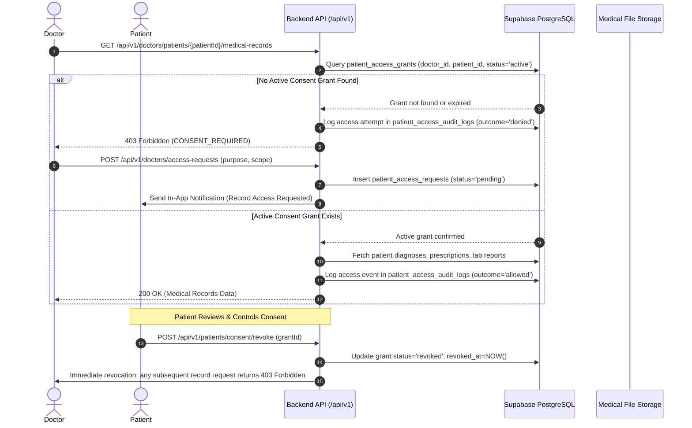

# Sushrut Healthcare Platform - Security & Compliance Architecture

## 1. Healthcare Security Principles & Compliance Context

The **Sushrut Healthcare Platform** is engineered following healthcare data privacy principles (consistent with HIPAA Security & Privacy Rules and the Digital Personal Data Protection Act):

1. **Principle of Least Privilege:** Users receive only the minimum level of access required to perform their specific role.
2. **Patient Data Sovereignty:** Patients are the sole owners of their medical records. No healthcare provider has automatic or permanent access to historical records.
3. **Strict Separation of Operational vs. Clinical Data:** Administrative staff oversee platform operations, verify medical licenses, and audit system logs, but have **zero access to clinical diagnoses, medical records, or health documents**.
4. **Storage Segregation:** Relational databases store structured tabular data; medical document binaries are never stored inside PostgreSQL.
5. **End-to-End Auditability:** Every view, download, consent grant, and revocation event is immutably recorded in access audit logs.

---

## 2. Role-Based Access Control (RBAC) Matrix

| Resource / Capability | Patient | Doctor | Laboratory | Administrator |
| :--- | :---: | :---: | :---: | :---: |
| **Search Doctors & Labs** | Full | Full | Full | Full |
| **Book Doctor Appointments** | Self | No | No | No |
| **Configure Doctor Availability** | No | Self | No | No |
| **View Patient Historical Records** | Self | **Consent Gated** | No | **Forbidden (403)** |
| **Request Patient Record Access** | No | Allowed | No | No |
| **Approve / Revoke Consent** | Self | No | No | No |
| **Create Diagnoses & Prescriptions** | No | Allowed (Own consultations) | No | No |
| **Upload Lab Reports** | No | No | Allowed (Own lab orders) | No |
| **Download Medical PDF Documents** | Self | **Consent Gated** | Own Lab Reports Only | **Forbidden (403)** |
| **Verify Doctors & Laboratories** | No | No | No | Allowed |
| **View System Audit Logs** | No | No | No | Allowed (No clinical payloads) |
| **View Sensitive Access Audit Logs** | Self | Self (own actions) | Self (own actions) | Operational metadata only |

---

## 3. Patient Consent & Permission Gatekeeper

The Sushrut **Gatekeeper** is a server-enforced consent engine governing access to all historical clinical data.



### Key Gatekeeper Characteristics:
- **Default Denied:** A confirmed appointment does not automatically grant clinical history access.
- **Explicit Purpose Specification:** Doctors must state clinical justification when requesting access.
- **Granular Scopes:** Grantees can be limited to `all_records`, `prescriptions_only`, `lab_reports_only`, or `single_appointment`.
- **Immediate Revocability:** When a patient revokes a grant, active consultations immediately lose access.
- **Access Audit Trail:** Every call to view records or stream PDFs writes an audit record with `patient_id`, `accessor_role`, `action`, `resource_id`, `ip_address`, and `outcome`.

---

## 4. Medical Document Privacy & Storage Security

### 4.1 Strict Storage Segregation
- Uploaded medical PDFs are **never stored as binary blobs (`BYTEA`, `BLOB`) or Base64 strings in PostgreSQL**.
- PostgreSQL only contains metadata:
  - Document ID (`RPT000001`)
  - Standardized filename
  - Storage path / key
  - File size in bytes
  - MIME type (`application/pdf`)
  - SHA-256 cryptographic checksum
  - Timestamps and relations

### 4.2 Standardized Cryptographic Filename Enforcement
All medical files are automatically renamed on the backend following strict patterns to prevent path traversal and identifier spoofing:

1. **Laboratory Reports:**
   ```text
   PATIENT_ID-TEST_ID-LAB_ID-REPORT_ID.pdf
   Example: PAI100001-TST000001-LAB100001-RPT000001.pdf
   ```

2. **Prescriptions:**
   ```text
   PATIENT_ID-DISEASE_ID-DOCTOR_ID-RECORD_ID.pdf
   Example: PAI100001-DIS000001-DOC100001-RPT000001.pdf
   ```

### 4.3 Zero Direct Public URLs
- PDF documents are stored outside the web root or in private object storage buckets with no public read permissions.
- Documents can only be retrieved via `GET /api/v1/documents/:documentId`.
- The streaming controller verifies JWT authentication, extracts the user role, checks patient consent (if doctor) or ownership (if patient/lab), and pipes the binary stream only if authorized.
- Requests from unauthorized users or administrators are immediately terminated with `403 Forbidden`.

---

## 5. Double-Booking Concurrency Protection

To prevent concurrent booking race conditions when multiple patients attempt to book the exact same 15-minute slot:

1. **Database-Level Unique Partial Index:**
   ```sql
   CREATE UNIQUE INDEX idx_no_double_booking 
   ON appointments(doctor_id, appointment_date, start_time) 
   WHERE status NOT IN ('cancelled');
   ```
2. **Application-Level Pre-Flight Locking:**
   The `AppointmentService.bookAppointment()` method executes a serialized validation check before persisting.
3. **Conflict Resolution:** If a duplicate booking is attempted, the database constraint triggers, and the API returns a structured `409 Conflict` response with an explanatory message: `"This consultation slot has already been booked. Please choose another time."`

---

## 6. Authentication & Session Security

- **Password Hashing:** Passwords are encrypted using Bcrypt with 10 salt rounds. Plaintext passwords are never logged, stored, or returned in API responses.
- **Stateless Tokens:** Access tokens are signed using HMAC-SHA256 with an environment-configured `JWT_SECRET`. Tokens expire automatically (default: 24 hours).
- **Session Revocation:** Supported via `refresh_tokens` table for remote sign-out across devices.
- **Credential Storage Rule:** Frontend code and client bundles contain zero database credentials, private storage keys, or service tokens.

---

## 7. Network & Perimeter Defenses

- **HTTP Security Headers:** Implemented via `helmet()` middleware (X-Content-Type-Options, X-Frame-Options: DENY, Strict-Transport-Security, X-XSS-Protection).
- **CORS Allowlisting:** Restricted to approved frontend origins; rejects arbitrary cross-origin requests.
- **Rate Limiting:** Protects against brute-force attacks on authentication routes (`/api/v1/auth/login`) and API denial of service.
- **Upload Validation:** `multer` middleware strictly validates MIME type (`application/pdf`) and enforces a 10MB maximum file size limit. File extensions are sanitized.
